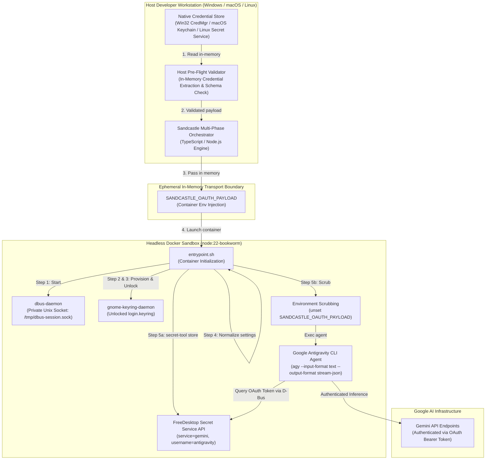
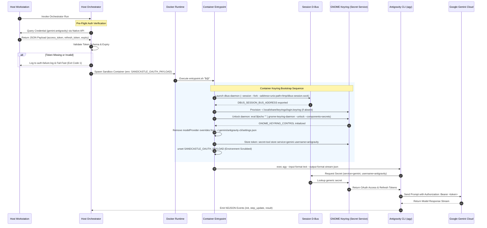
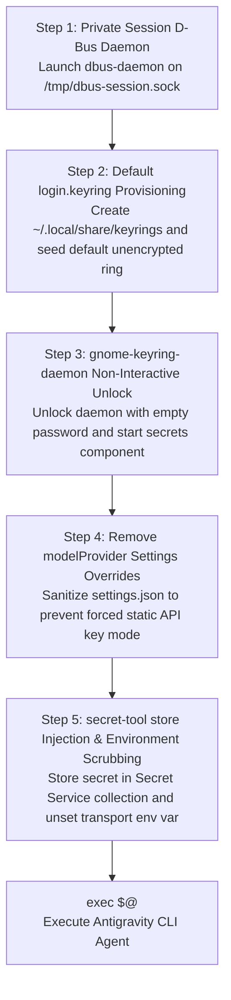
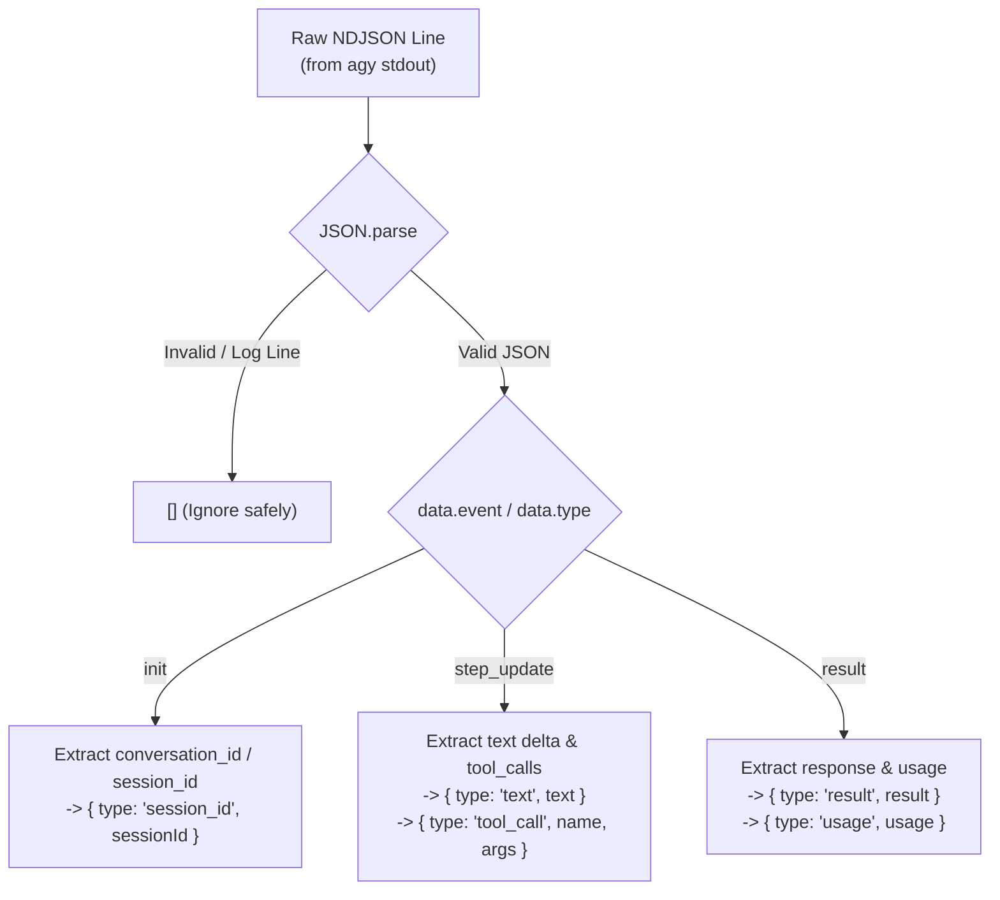
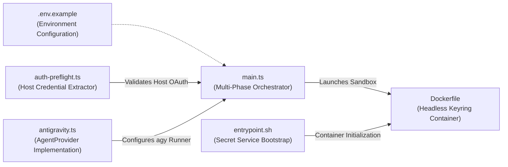

# Sandcastle Antigravity OAuth Session Bridge: Standalone Architecture & Integration Guide

A comprehensive, project-agnostic technical specification and implementation guide for running the Google Antigravity CLI (`agy`) autonomously inside headless Linux Docker sandboxes using an active host consumer OAuth subscription.

---

## Table of Contents

1. [Problem Statement & Motivation](#1-problem-statement--motivation)
   - [Why Consumer OAuth CLI Agents Fail in Headless Containers](#why-consumer-oauth-cli-agents-fail-in-headless-containers)
   - [Architectural Objectives & Trade-offs](#architectural-objectives--trade-offs)
2. [Architecture & End-to-End OAuth Bridge Flow](#2-architecture--end-to-end-oauth-bridge-flow)
   - [System Architecture Diagram](#system-architecture-diagram)
   - [End-to-End Sequence Diagram](#end-to-end-sequence-diagram)
   - [Security & Trust Boundaries](#security--trust-boundaries)
3. [Cross-Platform Host Pre-Flight & Credential Extraction](#3-cross-platform-host-pre-flight--credential-extraction)
   - [Windows Credential Manager Extraction (Win32 P/Invoke)](#windows-credential-manager-extraction-win32-pinvoke)
   - [macOS Keychain Extension](#macos-keychain-extension)
   - [Linux Secret Service Extension](#linux-secret-service-extension)
   - [Unified CredentialExtractor Contract](#unified-credentialextractor-contract)
   - [OAuth Payload Validation Schema](#oauth-payload-validation-schema)
   - [Fail-Fast Abort Semantics](#fail-fast-abort-semantics)
4. [Headless Container Keyring Bootstrap](#4-headless-container-keyring-bootstrap)
   - [Five-Step Container Initialization Sequence](#five-step-container-initialization-sequence)
   - [Step 1: Private Session D-Bus Daemon Initialization](#step-1-private-session-d-bus-daemon-initialization)
   - [Step 2: Unencrypted Default login.keyring Provisioning](#step-2-unencrypted-default-loginkeyring-provisioning)
   - [Step 3: Non-Interactive gnome-keyring-daemon Unlock](#step-3-non-interactive-gnome-keyring-daemon-unlock)
   - [Step 4: Removal of modelProvider Settings Overrides](#step-4-removal-of-modelprovider-settings-overrides)
   - [Step 5: secret-tool store Injection & Environment Scrubbing](#step-5-secret-tool-store-injection--environment-scrubbing)
5. [Sandcastle AgentProvider Implementation Deep-Dive](#5-sandcastle-agentprovider-implementation-deep-dive)
   - [The AgentProvider Interface Contract](#the-agentprovider-interface-contract)
   - [CLI Command Construction & Execution Flags](#cli-command-construction--execution-flags)
   - [NDJSON Stream Event Normalization](#ndjson-stream-event-normalization)
   - [Role-Scoped Model Resolution & Fallback Hierarchy](#role-scoped-model-resolution--fallback-hierarchy)
   - [Compound Model Identifier & Reasoning Effort Decomposition](#compound-model-identifier--reasoning-effort-decomposition)
6. [Complete Drop-In Userland Implementation](#6-complete-drop-in-userland-implementation)
   - [Architecture of the Drop-In Toolkit](#architecture-of-the-drop-in-toolkit)
   - [Listing 1: Host OAuth Pre-Flight Module (auth-preflight.ts)](#listing-1-host-oauth-pre-flight-module-auth-preflightts)
   - [Listing 2: Antigravity Agent Provider (antigravity.ts)](#listing-2-antigravity-agent-provider-antigravityts)
   - [Listing 3: Headless Keyring Container Image (Dockerfile)](#listing-3-headless-keyring-container-image-dockerfile)
   - [Listing 4: Container Entrypoint Bootstrap Script (entrypoint.sh)](#listing-4-container-entrypoint-bootstrap-script-entrypointsh)
   - [Listing 5: Multi-Phase Orchestrator Runner (main.ts)](#listing-5-multi-phase-orchestrator-runner-maints)
   - [Listing 6: Environment Configuration Template (.env.example)](#listing-6-environment-configuration-template-envexample)
7. [Upstream Fork Blueprint for @ai-hero/sandcastle](#7-upstream-fork-blueprint-for-ai-herosandcastle)
8. [Social Media & Technical Blog Post Kit](#8-social-media--technical-blog-post-kit)

---

## 1. Problem Statement & Motivation

Autonomous multi-agent orchestration frameworks (such as Sandcastle) run developer agents inside isolated, ephemeral Docker container sandboxes. While commercial agent CLIs natively support static API keys via simple environment variables (e.g., `OPENAI_API_KEY`, `ANTHROPIC_API_KEY`), using static API keys for Google Gemini or Google Antigravity presents significant drawbacks:
- It incurs separate, metered, per-token API billing rather than leveraging existing developer or enterprise subscriptions (such as Google AI Pro or Ultra).
- It increases secret sprawl across distributed worker nodes and CI/CD environments.
- It introduces severe security risks of API key leakage in container logs, process tables, or committed code diffs.

The Google Antigravity CLI (`agy`) solves this for interactive developers on desktop workstations by authenticating via a consumer Google OAuth 2.0 flow and caching the resulting token pair (`access_token`, `refresh_token`, and `expiry`) in the host operating system's native credential store. 

However, attempting to run `agy` directly inside headless Linux container sandboxes causes immediate, fatal execution failures due to four core architectural barriers:

### Why Consumer OAuth CLI Agents Fail in Headless Containers

1. **Lack of Interactive Browser Login & Redirect Loop**:
   Desktop OAuth login requires launching a local browser or rendering a GUI window to prompt the user for interactive login and consent, followed by redirecting to a local HTTP callback listener (e.g., `http://localhost:<port>/oauth/callback`) or displaying an authorization code. Headless Docker sandboxes lack a desktop environment, an X11/Wayland display server, and an interactive browser. Running an interactive login flow inside an automated sandbox breaks unattended execution and halts autonomous pipeline runs.

2. **Absence of an Active D-Bus Session Bus**:
   On Linux platforms, the Antigravity CLI binary uses the FreeDesktop Secret Service specification (via the standard Go `keyring` client library) to securely persist and retrieve OAuth tokens. The FreeDesktop Secret Service specification communicates over the Inter-Process Communication (IPC) D-Bus session bus. Minimal headless container images (e.g., Debian, Ubuntu, Alpine) do not run an active user session bus daemon (`dbus-daemon --session`) or systemd user managers (`systemd --user`). Consequently, when `agy` attempts to connect to the socket identified by `DBUS_SESSION_BUS_ADDRESS`, the connection fails immediately with `dial unix /run/user/1000/bus: connect: no such file or directory`.

3. **Locked or Unprovisioned GNOME Keyring Collection**:
   Even if a D-Bus daemon is started manually, standard Secret Service providers like GNOME Keyring (`gnome-keyring-daemon`) depend on PAM (`pam_gnome_keyring.so`) during graphical desktop login to provision and unlock the default `login` keyring using the user's desktop password. In a headless container, no PAM session exists: the default keyring is either entirely absent or locked. When an unprivileged process requests access, `gnome-keyring-daemon` attempts to invoke an interactive graphical pinentry prompt or errors out with `org.freedesktop.Secret.Error.IsLocked: Collection is locked`.

4. **Static `modelProvider` Configuration Overrides**:
   When developer tooling or base images pre-populate CLI configuration files (such as `~/.gemini/antigravity-cli/settings.json`) or set environment variables with explicit `modelProvider` overrides, the Antigravity binary is forced into a static API key mode. In this mode, the binary bypasses the OAuth keyring credential store altogether and fails immediately with missing API key errors, ignoring any valid OAuth tokens present in the system.

### Architectural Objectives & Trade-offs

To enable autonomous, unattended execution without paying per-token API costs or compromising security, the **Host OAuth Session Bridge** fulfills five fundamental criteria:
- **Zero Interactive Prompts**: Eliminate any interactive browser or PIN prompts inside container sandboxes.
- **Cross-OS Keyring Bridging**: Bridge credentials from any host OS (Windows Credential Manager, macOS Keychain, Linux Secret Service) into the container's standard FreeDesktop Secret Service interface.
- **In-Memory Transport & Scrubbing**: Never write unencrypted tokens to the host disk; inject credentials ephemerally into container memory and scrub transport environment variables before invoking agent processes.
- **Fail-Fast Pre-Flight Gate**: Validate token structure and freshness prior to worktree creation or container launch, avoiding stalled or dirty repository states.
- **Zero Upstream Modifications**: Interface seamlessly with the stock `agy` binary and standard container runtimes without requiring custom forks or patched binaries.

---

## 2. Architecture & End-to-End OAuth Bridge Flow

The Host OAuth Session Bridge establishes a secure, ephemeral bridge between the developer's desktop credential store and the headless container sandbox.

### System Architecture Diagram



### End-to-End Sequence Diagram



### Security & Trust Boundaries

1. **No Host Plaintext Persistence**: The host pre-flight verification retrieves credential blobs directly from Windows Credential Manager or native keyrings into memory. No intermediate JSON token files are saved to the host filesystem.
2. **Fail-Fast Boundary**: The pre-flight check executes before provisioning any Git branches, worktrees, or Docker containers. An authentication failure terminates execution with exit code 1, leaving zero residual or dirty repository state.
3. **In-Memory Environment Transport**: Credentials travel across the Docker boundary via `SANDCASTLE_OAUTH_PAYLOAD`.
4. **Immediate Container Scrubbing**: As soon as `secret-tool store` loads the payload into the in-memory Secret Service collection, `entrypoint.sh` executes `unset SANDCASTLE_OAUTH_PAYLOAD`. Subsequent child processes or external inspections of `/proc/<pid>/environ` cannot access the raw payload.
5. **Filesystem Protection**: Local cache files (`~/.gemini/antigravity-cli/antigravity-oauth-token` and keyring stores) are restricted to `chmod 600` permissions.

---

## 3. Cross-Platform Host Pre-Flight & Credential Extraction

The orchestrator pre-flight module ensures that a valid OAuth session exists before allocating any system resources. It queries the target credential `gemini:antigravity` using the host operating system's native API.

### Windows Credential Manager Extraction (Win32 P/Invoke)

On Windows desktop hosts, the Antigravity CLI persists generic credentials in Windows Credential Manager under the target identifier `gemini:antigravity`. The pre-flight check extracts this credential directly in memory using PowerShell with C# Platform Invoke (P/Invoke) bindings to the Win32 `CredReadW` function exported by `advapi32.dll`.

#### Win32 `CredReadW` Mechanics
The `CredReadW` API takes three arguments:
- `TargetName`: The UTF-16 target name (`gemini:antigravity`).
- `Type`: `CRED_TYPE_GENERIC = 1`.
- `ReservedFlag`: `0`.
Upon success, the OS allocates a native `CREDENTIALW` struct in unmanaged memory. The script copies the `CredentialBlob` bytes using `[System.Runtime.InteropServices.Marshal]::Copy` into a managed byte array, converts them to a UTF-8 string, and calls `CredFree` to immediately release unmanaged memory.

#### PowerShell Extraction Script
```powershell
$code = @"
using System;
using System.Runtime.InteropServices;

public class CredManager {
    [DllImport("advapi32.dll", EntryPoint = "CredReadW", CharSet = CharSet.Unicode, SetLastError = true)]
    public static extern bool CredRead(string target, int type, int reservedFlag, out IntPtr credentialPtr);

    [DllImport("advapi32.dll", EntryPoint = "CredFree", SetLastError = true)]
    public static extern void CredFree(IntPtr cred);

    [StructLayout(LayoutKind.Sequential, CharSet = CharSet.Unicode)]
    public struct CREDENTIAL {
        public int Flags;
        public int Type;
        public string TargetName;
        public string Comment;
        public long LastWritten;
        public int CredentialBlobSize;
        public IntPtr CredentialBlob;
        public int Persist;
        public int AttributeCount;
        public IntPtr Attributes;
        public string TargetAlias;
        public string UserName;
    }

    public static string ReadGenericCredential(string target) {
        IntPtr credPtr;
        // CRED_TYPE_GENERIC = 1
        if (CredRead(target, 1, 0, out credPtr)) {
            try {
                CREDENTIAL cred = (CREDENTIAL)Marshal.PtrToStructure(credPtr, typeof(CREDENTIAL));
                if (cred.CredentialBlobSize > 0 && cred.CredentialBlob != IntPtr.Zero) {
                    byte[] blob = new byte[cred.CredentialBlobSize];
                    Marshal.Copy(cred.CredentialBlob, blob, 0, cred.CredentialBlobSize);
                    return System.Text.Encoding.UTF8.GetString(blob);
                }
            } finally {
                CredFree(credPtr);
            }
        }
        return null;
    }
}
"@

Add-Type -TypeDefinition $code -Language CSharp
$secret = [CredManager]::ReadGenericCredential("gemini:antigravity")
if ($secret) {
    Write-Output $secret
} else {
    exit 1
}
```

### macOS Keychain Extension

On macOS hosts, the Antigravity CLI stores credentials in the user login keychain under service name `gemini` and account `antigravity`.

Extraction command:
```bash
security find-generic-password -s "gemini" -a "antigravity" -w
```
The command writes the plaintext secret directly to standard output. If the password does not exist, `security` exits with non-zero exit code `44` (`errSecItemNotFound`), signaling the pre-flight extractor to trigger remediation.

### Linux Secret Service Extension

On Linux desktop hosts with an active desktop environment, the Antigravity CLI persists credentials to the default Secret Service collection using FreeDesktop D-Bus protocols.

Extraction command:
```bash
secret-tool lookup service gemini username antigravity
```
If the item exists, `secret-tool` prints the raw secret to standard output with exit code `0`. If not found, it prints nothing and exits with code `1`.

### Unified CredentialExtractor Contract

To support multi-platform orchestrators cleanly, host extraction is encapsulated behind a unified TypeScript interface:

```typescript
export type HostPlatform = "win32" | "darwin" | "linux";

export interface ExtractCredentialOptions {
  target?: string;
  service?: string;
  account?: string;
  runner?: (command: string, args: string[]) => { status: number; stdout: string };
}

export type CredentialExtractor = (
  target: string,
  options?: ExtractCredentialOptions,
) => string | null;

export interface PlatformExtractorMap {
  win32: CredentialExtractor;
  darwin: CredentialExtractor;
  linux: CredentialExtractor;
}
```

### OAuth Payload Validation Schema

Once extracted as a raw string, the payload must be verified against a strict schema. The Antigravity CLI stores OAuth tokens in either a nested structure (under a `token` sub-object) or as a flat JSON root object. The validator normalizes both shapes:

```typescript
export interface OAuthTokenData {
  access_token: string;
  refresh_token: string;
  expiry: string;
  token_type?: string;
}

export interface AuthPreflightResult {
  rawPayload: string;
  token: OAuthTokenData;
}

export function validateOAuthPayload(raw: string | null | undefined): OAuthTokenData {
  if (!raw || typeof raw !== "string" || raw.trim().length === 0) {
    throw new Error("OAuth credential payload is empty");
  }

  let parsed: unknown;
  try {
    parsed = JSON.parse(raw);
  } catch (err) {
    throw new Error(`Failed to parse OAuth credential as JSON: ${(err as Error).message}`);
  }

  if (typeof parsed !== "object" || parsed === null) {
    throw new Error("OAuth credential JSON must be an object");
  }

  // Handle both nested { token: { ... } } and flat { ... } formats
  const candidate = (parsed as { token?: Record<string, unknown> }).token ?? (parsed as Record<string, unknown>);

  const { access_token, refresh_token, expiry } = candidate;

  if (typeof access_token !== "string" || access_token.trim().length === 0) {
    throw new Error("OAuth credential missing valid 'access_token'");
  }

  if (typeof refresh_token !== "string" || refresh_token.trim().length === 0) {
    throw new Error("OAuth credential missing valid 'refresh_token'");
  }

  if (typeof expiry !== "string" || isNaN(Date.parse(expiry))) {
    throw new Error("OAuth credential missing valid 'expiry' date string");
  }

  return {
    access_token,
    refresh_token,
    expiry,
    token_type: typeof candidate.token_type === "string" ? candidate.token_type : "Bearer",
  };
}
```

### Fail-Fast Abort Semantics

The pre-flight gate executes immediately when the orchestrator starts:
1. **Prior to Worktree / Sandbox Creation**: Checks occur before creating Git worktree directories, checking out branches, or invoking `docker run`.
2. **Structured Diagnostic Logging**: If extraction returns `null` or validation throws, the error is appended to `.sandcastle/logs/auth-failure.log` with a full timestamp, error reason, and host OS platform.
3. **Actionable Remediation**: The CLI prints a clear diagnostic banner to `stderr`:
   ```
   [ERROR] Sandcastle Host OAuth Pre-Flight Failed:
   Missing or expired Antigravity OAuth session credentials.
   To authenticate your host session, please run:
       agy
   and complete the interactive browser login before launching the orchestrator.
   ```
4. **Clean Exit**: Exits immediately via `process.exit(1)`. The repository working tree remains pristine (`git status --porcelain` is empty).

---

## 4. Headless Container Keyring Bootstrap

Inside the Linux Docker sandbox, the container entrypoint (`entrypoint.sh`) prepares the headless environment before handing execution over to the Antigravity agent process.

### Five-Step Container Initialization Sequence

The entrypoint executes five discrete initialization steps:



### Step 1: Private Session D-Bus Daemon Initialization

The container ensures a dedicated D-Bus session bus is available by launching `dbus-daemon` on a predictable Unix domain socket:

```bash
DBUS_SOCKET="/tmp/dbus-session.sock"
if [ ! -S "$DBUS_SOCKET" ]; then
    rm -f "$DBUS_SOCKET" /tmp/dbus-session.pid
    dbus-daemon --session --fork \
        --address="unix:path=$DBUS_SOCKET" \
        --print-pid > /tmp/dbus-session.pid
fi
export DBUS_SESSION_BUS_ADDRESS="unix:path=$DBUS_SOCKET"
```

Exporting `DBUS_SESSION_BUS_ADDRESS` informs all D-Bus client libraries (including `libsecret` and the Go `dbus` package) of the socket location.

### Step 2: Unencrypted Default `login.keyring` Provisioning

GNOME Keyring requires a default keyring collection named `login`. When absent, the daemon cannot store credentials. Rather than using an unparsed INI text template which modern GNOME Keyring versions can reject as malformed, the entrypoint provisions an unencrypted default keyring containing the valid binary header (`GnomeKeyring`) via base64 decoding:

```bash
KEYRINGS_DIR="$HOME/.local/share/keyrings"
mkdir -p "$KEYRINGS_DIR"
chmod 700 "$KEYRINGS_DIR"

if [ ! -f "$KEYRINGS_DIR/login.keyring" ]; then
    cat << 'EOF' | base64 -d > "$KEYRINGS_DIR/login.keyring"
R25vbWVLZXlyaW5nCg0ACgAAAAAAAAAFTG9naW4AAAAAAAAAAAAAAABqrZxvAAAAAAAAAAAAAA8n
6V77zmJg8NQAAAAAAAAAAAAAAAAAAAAAAAAAAAAAABA4s+TSntR6uFMIx7D55Z4+
EOF
    echo "login" > "$KEYRINGS_DIR/default"
    chmod 600 "$KEYRINGS_DIR/login.keyring" "$KEYRINGS_DIR/default"
fi
```

### Step 3: Non-Interactive `gnome-keyring-daemon` Unlock

To prevent the daemon from blocking on interactive graphical pinentry prompts, `gnome-keyring-daemon` is launched and unlocked non-interactively by feeding an empty newline into `--unlock`:

```bash
eval $(echo "" | gnome-keyring-daemon --unlock --components=secrets 2>/dev/null)
export GNOME_KEYRING_CONTROL
```

This starts the FreeDesktop Secret Service D-Bus provider with an unlocked keyring ready to accept read and write requests.

### Step 4: Removal of `modelProvider` Settings Overrides

If the user's home configuration or a base image contains static provider configurations, the CLI may fail to use the OAuth session. The entrypoint normalizes `settings.json`:

```bash
SETTINGS_FILE="$HOME/.gemini/antigravity-cli/settings.json"
mkdir -p "$(dirname "$SETTINGS_FILE")"
if [ -f "$SETTINGS_FILE" ]; then
    # Filter out static modelProvider overrides if jq is available, or delete conflicting file
    if command -v jq >/dev/null 2>&1; then
        jq 'del(.modelProvider)' "$SETTINGS_FILE" > "${SETTINGS_FILE}.tmp" && mv "${SETTINGS_FILE}.tmp" "$SETTINGS_FILE"
    fi
else
    echo '{}' > "$SETTINGS_FILE"
fi
```

### Step 5: `secret-tool store` Injection & Environment Scrubbing

The final step injects the payload into the Secret Service store, writes a secondary local cache fallback (`chmod 600`), and immediately scrubs the transport environment variable:

```bash
if [ -n "$SANDCASTLE_OAUTH_PAYLOAD" ]; then
    # Secondary local token cache fallback
    mkdir -p "$HOME/.gemini/antigravity-cli"
    printf '%s' "$SANDCASTLE_OAUTH_PAYLOAD" > "$HOME/.gemini/antigravity-cli/antigravity-oauth-token"
    chmod 600 "$HOME/.gemini/antigravity-cli/antigravity-oauth-token"

    # Inject into FreeDesktop Secret Service via secret-tool with retry loop
    for i in $(seq 1 15); do
        if printf '%s' "$SANDCASTLE_OAUTH_PAYLOAD" | secret-tool store \
            --label="gemini:antigravity" \
            service gemini \
            username antigravity 2>/dev/null; then
            break
        fi
        sleep 0.2
    done

    # Crucial security boundary: Scrub environment variable from process memory
    unset SANDCASTLE_OAUTH_PAYLOAD
fi

# Execute requested agent command
exec "$@"
```

Once `unset SANDCASTLE_OAUTH_PAYLOAD` executes, the token only resides in the memory of the background keyring daemon and inside `antigravity-oauth-token` (`chmod 600`). Sub-processes, debugging tools, or error handlers running in user space cannot read the token from environment variables.

---

## 5. Sandcastle AgentProvider Implementation Deep-Dive

Autonomous multi-agent orchestration frameworks like Sandcastle (`@ai-hero/sandcastle`) decouple high-level pipeline orchestration from vendor-specific coding agent CLIs via the `AgentProvider` abstraction interface. Rather than coupling the orchestrator to a single vendor SDK, an `AgentProvider` serves as a bidirectional adapter: it formats model configuration and user prompts into concrete CLI execution commands, and parses asynchronous streaming terminal output lines back into strongly-typed execution events.

This section details how the custom Antigravity `AgentProvider` is engineered to interface directly with the Google Antigravity CLI (`agy`) inside headless container sandboxes.

### The AgentProvider Interface Contract

The Sandcastle agent provider contract defines the operational seam between the multi-phase runner and the containerized agent CLI:

```typescript
export interface PrintCommand {
  readonly command: string;
  readonly stdin?: string;
}

export interface AgentCommandOptions {
  readonly prompt: string;
  readonly dangerouslySkipPermissions?: boolean;
}

export type ParsedStreamEvent =
  | { readonly type: "text"; readonly text: string }
  | { readonly type: "result"; readonly result: string }
  | { readonly type: "tool_call"; readonly name: string; readonly args: string }
  | { readonly type: "session_id"; readonly sessionId: string }
  | {
      readonly type: "usage";
      readonly usage: {
        readonly inputTokens: number;
        readonly cacheCreationInputTokens: number;
        readonly cacheReadInputTokens: number;
        readonly outputTokens: number;
      };
    };

export interface AgentProvider {
  readonly name: string;
  readonly env: Record<string, string>;
  readonly captureSessions: boolean;
  buildPrintCommand(options: AgentCommandOptions): PrintCommand;
  parseStreamLine(line: string): ParsedStreamEvent[];
}
```

The provider handles two critical responsibilities:
1. **Command Generation (`buildPrintCommand`)**: Translates agent options (model tier, reasoning effort budget, execution mode, permission bypass) and prompt instructions into a shell command and standard input stream.
2. **Stream Event Parsing (`parseStreamLine`)**: Ingests newline-delimited JSON (NDJSON) output emitted by `agy --output-format stream-json` on `stdout` and normalizes arbitrary JSON messages into strongly-typed Sandcastle stream events.

### CLI Command Construction & Execution Flags

When Sandcastle invokes an agent turn, `buildPrintCommand(options)` generates the CLI execution invocation:

```bash
agy --input-format text --output-format stream-json --dangerously-skip-permissions --mode accept-edits --model gemini-4-argon --effort high
```

Each CLI flag fulfills an explicit operational requirement in unattended container environments:

- `--input-format text`: Instructs the CLI that task prompt data supplied over standard input is formatted as raw text or markdown, bypassing terminal prompt wrappers.
- `--output-format stream-json`: Instructs the CLI to emit structured events as newline-delimited JSON objects over `stdout`. This allows the orchestrator to capture real-time streaming deltas, tool actions, and token metrics.
- `--dangerously-skip-permissions`: Crucial for automated container runs. Bypasses all interactive human confirmation prompts when the agent invokes tools (reading files, editing files, running shell commands). Without this flag, tool execution blocks awaiting terminal input on non-existent interactive TTYs, causing execution timeouts.
- `--mode <accept-edits | plan>`: Configures agent operational behavior:
  - `accept-edits` (default): Active coding mode where the agent creates/edits files, executes tests, and makes commits.
  - `plan`: Read-only architectural planning mode where the agent inspects the workspace and produces analysis without modifying repository files.
- `--model <model>`: Explicit model name passed to the Gemini backend (e.g. `gemini-4-argon` or `gemini-3.8-flash`).
- `--effort <low | medium | high>`: Directs the reasoning budget allocated to Gemini thinking models.

#### Safe Prompt Delivery via Standard Input (`stdin`)

Passing large system prompts, issue descriptions, and repository guidelines as CLI arguments risks exceeding OS command buffer limits (`ARG_MAX`), introducing shell quoting errors, or enabling command injection. 

To eliminate these vulnerabilities, `buildPrintCommand` returns the complete prompt in the `stdin` property of `PrintCommand`:

```typescript
return {
  command: parts.join(" "),
  stdin: commandOptions.prompt,
};
```

The Sandcastle execution engine launches the container process and streams the `stdin` string directly into the process input stream.

### NDJSON Stream Event Normalization

When running with `--output-format stream-json`, the `agy` CLI outputs single-line JSON records separated by newlines. The `parseAntigravityStreamLine` parser maps these events into the standard Sandcastle event model:



#### 1. Session Initialization (`init`)
Announced at session start to convey the unique conversation identifier:
```json
{"event":"init","conversation_id":"c6b986fb-1e8b-4bcf-a5ea-55268ee7f2b1"}
```
The parser extracts `conversation_id`, `session_id`, `sessionId`, `id`, or nested `init.conversation_id` and emits:
```typescript
{ type: "session_id", sessionId: "c6b986fb-1e8b-4bcf-a5ea-55268ee7f2b1" }
```

#### 2. Incremental Step Updates (`step_update`)
Emitted as the agent reasons, edits files, and invokes tools:
- **Streaming Text Delta**:
  ```json
  {"event":"step_update","step_update":{"delta":"Analyzing repository structure..."}}
  ```
  Parsed into `{ type: "text", text: "Analyzing repository structure..." }`.
- **Tool Invocations**:
  ```json
  {"event":"step_update","step_update":{"tool_calls":[{"name":"read_file","arguments":{"Path":"package.json"}}]}}
  ```
  Parsed into `{ type: "tool_call", name: "read_file", args: "{"Path":"package.json"}" }`.
- **Tool Response Output**:
  ```json
  {"event":"step_update","step_update":{"tool_result":"File content..."}}
  ```
  Parsed into `{ type: "text", text: "File content..." }`.

#### 3. Terminal Result (`result`)
Emitted when the turn concludes, containing the final markdown response:
```json
{"event":"result","result":{"response":"All tasks completed successfully.","usage":{"inputTokens":1250,"outputTokens":380}}}
```
Parsed into:
```typescript
{ type: "result", result: "All tasks completed successfully." }
```

#### 4. Token Accounting Metrics (`usage`)
Extracted from `result.usage` or top-level `usage` objects, normalizing property casing differences:
```typescript
{
  type: "usage",
  usage: {
    inputTokens: 1250,
    cacheCreationInputTokens: 0,
    cacheReadInputTokens: 0,
    outputTokens: 380,
  }
}
```

### Role-Scoped Model Resolution & Fallback Hierarchy

Complex multi-phase orchestration workflows require distinct model profiles across phases:
- **Planner Agent (`PLANNER_MODEL`)**: Evaluates repository architecture and open issues. Requires high reasoning depth and broad context (e.g. `gemini-4-argon-high`).
- **Implementer Agent (`IMPLEMENTER_MODEL`)**: Performs repetitive edit-test-debug loops. Demands high generation speed and high context throughput (e.g. `gemini-3.8-flash-high`).
- **Reviewer Agent (`REVIEWER_MODEL`)**: Audits git diffs against specifications and coding standards (e.g. `gemini-3.8-flash-medium`).
- **Merger Agent (`MERGER_MODEL`)**: Reconciles divergent branches and resolves merge conflicts (e.g. `gemini-4-argon-high`).

The `resolveRoleModel` utility resolves the target model through a 5-tier precedence hierarchy:

```mermaid
flowchart TD
    START["Resolve Model for Role (e.g., 'planner')"] --> CHECK_OPT{options.model explicitly passed?}
    CHECK_OPT -->|Yes| USE_OPT[Use options.model]
    CHECK_OPT -->|No| CHECK_ROLE_MODELS{options.roleModels[role] defined?}
    CHECK_ROLE_MODELS -->|Yes| USE_ROLE_MODELS[Use options.roleModels[role]]
    CHECK_ROLE_MODELS -->|No| CHECK_ROLE_ENV{ROLE_ENV_VARS[role] in process.env?
(PLANNER_MODEL, IMPLEMENTER_MODEL, etc.)}
    CHECK_ROLE_ENV -->|Yes| USE_ROLE_ENV[Use process.env[ROLE_ENV_VARS[role]]]
    CHECK_ROLE_ENV -->|No| CHECK_AGENT_ENV{AGENT_MODEL in process.env?}
    CHECK_AGENT_ENV -->|Yes| USE_AGENT_ENV[Use process.env.AGENT_MODEL]
    CHECK_AGENT_ENV -->|No| USE_FALLBACK[Fallback: undefined / provider default]
```

### Compound Model Identifier & Reasoning Effort Decomposition

Developers frequently configure compound model names that combine the model family with a reasoning effort tier, such as `gemini-4-argon-high` or `gemini-3.8-flash-medium`.

Because the `agy` CLI takes separate `--model` and `--effort` options, the `parseModelIdentifier` function parses these identifiers using the regular expression `/^(.*?)-(low|medium|high)$/i`:

```typescript
export function parseModelIdentifier(
  modelIdentifier?: string,
  fallbackEffort?: "low" | "medium" | "high",
): ParsedModelConfig {
  if (!modelIdentifier) {
    return { model: undefined, effort: fallbackEffort };
  }

  const trimmed = modelIdentifier.trim();
  const match = trimmed.match(/^(.*?)-(low|medium|high)$/i);
  if (match) {
    return {
      model: match[1],
      effort: match[2].toLowerCase() as "low" | "medium" | "high",
    };
  }

  return {
    model: trimmed,
    effort: fallbackEffort,
  };
}
```

#### Suffix Decomposition Mapping

| Compound Model Config | Extracted CLI `--model` | Extracted CLI `--effort` |
| :--- | :--- | :--- |
| `gemini-4-argon-high` | `gemini-4-argon` | `high` |
| `gemini-3.8-flash-high` | `gemini-3.8-flash` | `high` |
| `gemini-3.8-flash-medium` | `gemini-3.8-flash` | `medium` |
| `gemini-3.8-flash-low` | `gemini-3.8-flash` | `low` |
| `gemini-4-argon` (with default effort) | `gemini-4-argon` | `high` |
| `gemini-3.8-flash` (no effort passed) | `gemini-3.8-flash` | *(flag omitted)* |

---

## 6. Complete Drop-In Userland Implementation

This section provides complete, fully-sanitized, copy-pasteable source code listings that enable any developer or team to adopt the Antigravity OAuth bridge immediately in an existing `@ai-hero/sandcastle` installation.

> [!NOTE]
> **Language-Agnostic Core Patterns**: While the drop-in listings below interface with Sandcastle's TypeScript/Node.js runtime, the underlying architectural mechanisms—Win32 `CredReadW` P/Invoke, macOS `security find-generic-password`, Linux FreeDesktop `secret-tool`, headless D-Bus socket lifecycle, unencrypted `login.keyring` binary payload, and `agy` NDJSON stream protocol—are completely language-agnostic systems specifications easily replicated in Python, Go, Rust, or custom CI/CD runners.

### Architecture of the Drop-In Toolkit

All six files use generic defaults, zero proprietary build toolchains, and project-agnostic Git configurations:



The six drop-in files are:
1. `auth-preflight.ts`: Host pre-flight credential validator and in-memory reader.
2. `antigravity.ts`: Standalone Sandcastle `AgentProvider` for the Antigravity CLI.
3. `Dockerfile`: Minimal Debian Bookworm container image with D-Bus, GNOME Keyring, and `agy`.
4. `entrypoint.sh`: Container entrypoint script initializing D-Bus, unlocking the keyring, and scrubbing environment variables.
5. `main.ts`: Parallel planner-executor-reviewer-merger orchestrator loop.
6. `.env.example`: Configuration template documenting token requirements and phase-scoped model variables.

---

### Listing 1: Host OAuth Pre-Flight Module (`auth-preflight.ts`)

Save as `.sandcastle/auth-preflight.ts`:

```typescript
/**
 * Host OAuth Pre-flight Validation and Extraction Utility for Sandcastle.
 *
 * Queries host credential storage for the Antigravity CLI generic credential
 * (`gemini:antigravity`), validates the contained OAuth token structure,
 * and logs structured diagnostic entries with actionable remediation instructions
 * if authentication is missing or corrupt.
 */

import { spawnSync } from "node:child_process";
import { appendFileSync, mkdirSync } from "node:fs";
import { dirname, resolve } from "node:path";

export const DEFAULT_CREDENTIAL_TARGET = "gemini:antigravity";
export const DEFAULT_LOG_PATH = resolve(process.cwd(), ".sandcastle/logs/auth-failure.log");

export interface OAuthTokenData {
  readonly access_token: string;
  readonly refresh_token: string;
  readonly expiry: string;
  readonly token_type?: string;
}

export interface AntigravityOAuthPayload {
  readonly token: OAuthTokenData;
  readonly auth_method?: string;
  readonly id_token?: string;
  readonly [key: string]: unknown;
}

export type CommandRunner = (
  command: string,
  args: string[],
) => {
  status: number | null;
  stdout: string;
  stderr: string;
};

export interface ExtractCredentialOptions {
  readonly runner?: CommandRunner;
  readonly platform?: string;
}

export type ValidationResult =
  | {
      readonly valid: true;
      readonly payload: string;
      readonly token: OAuthTokenData;
      readonly parsed: AntigravityOAuthPayload;
    }
  | {
      readonly valid: false;
      readonly error: string;
    };

export interface AuthPreflightOptions {
  readonly target?: string;
  readonly logPath?: string;
  readonly consoleError?: (message: string) => void;
  readonly exitFn?: (code: number) => never | void;
  readonly credentialReader?: (target: string) => string | null;
  readonly runner?: CommandRunner;
  readonly platform?: string;
}

export interface AuthPreflightSuccess {
  readonly payload: string;
  readonly token: OAuthTokenData;
  readonly parsed: AntigravityOAuthPayload;
}

const DEFAULT_RUNNER: CommandRunner = (command, args) => {
  const result = spawnSync(command, args, {
    encoding: "utf-8",
    windowsHide: true,
  });
  return {
    status: result.status,
    stdout: result.stdout ?? "",
    stderr: result.stderr ?? "",
  };
};

/**
 * Builds the C# P/Invoke script executed inside PowerShell to query
 * CredReadW from Advapi32.dll for a generic credential.
 */
function buildCredReadScript(target: string): string {
  const escapedTarget = target.replace(/'/g, "''");
  return `
$code = @"
using System;
using System.Runtime.InteropServices;
public class WinCredReader {
    [StructLayout(LayoutKind.Sequential, CharSet = CharSet.Unicode)]
    public struct CREDENTIAL {
        public int Flags;
        public int Type;
        public IntPtr TargetName;
        public IntPtr Comment;
        public System.Runtime.InteropServices.ComTypes.FILETIME LastWritten;
        public int CredentialBlobSize;
        public IntPtr CredentialBlob;
        public int Persist;
        public int AttributeCount;
        public IntPtr Attributes;
        public IntPtr TargetAlias;
        public IntPtr UserName;
    }

    [DllImport("Advapi32.dll", SetLastError = true, EntryPoint = "CredReadW", CharSet = CharSet.Unicode)]
    public static extern bool CredRead(string target, int type, int reservedFlag, out IntPtr credentialPtr);

    [DllImport("Advapi32.dll", SetLastError = true, EntryPoint = "CredFree")]
    public static extern void CredFree(IntPtr credentialPtr);
}
"@
Add-Type -TypeDefinition $code -Language CSharp
$ptr = [IntPtr]::Zero
$result = [WinCredReader]::CredRead('${escapedTarget}', 1, 0, [ref]$ptr)
if ($result -and $ptr -ne [IntPtr]::Zero) {
    try {
        $cred = [System.Runtime.InteropServices.Marshal]::PtrToStructure($ptr, [Type][WinCredReader+CREDENTIAL])
        if ($cred.CredentialBlobSize -gt 0 -and $cred.CredentialBlob -ne [IntPtr]::Zero) {
            $bytes = New-Object byte[] $cred.CredentialBlobSize
            [System.Runtime.InteropServices.Marshal]::Copy($cred.CredentialBlob, $bytes, 0, $cred.CredentialBlobSize)
            [System.Text.Encoding]::UTF8.GetString($bytes)
        }
    } finally {
        [WinCredReader]::CredFree($ptr)
    }
}
`;
}

/**
 * Extracts generic credential from Windows Credential Manager via P/Invoke.
 */
export function extractWindowsCredential(
  target: string = DEFAULT_CREDENTIAL_TARGET,
  options?: ExtractCredentialOptions,
): string | null {
  const platform = options?.platform ?? process.platform;
  if (platform !== "win32") {
    return null;
  }

  const runner = options?.runner ?? DEFAULT_RUNNER;
  const script = buildCredReadScript(target);

  try {
    const result = runner("powershell", [
      "-NoProfile",
      "-NonInteractive",
      "-Command",
      script,
    ]);

    if (result.status === 0 && result.stdout) {
      const trimmed = result.stdout.trim();
      return trimmed.length > 0 ? trimmed : null;
    }
    return null;
  } catch {
    return null;
  }
}

/**
 * Extracts generic credential from macOS Keychain using security CLI.
 */
export function extractMacCredential(
  target: string = DEFAULT_CREDENTIAL_TARGET,
  options?: ExtractCredentialOptions,
): string | null {
  const runner = options?.runner ?? DEFAULT_RUNNER;
  try {
    const result = runner("security", [
      "find-generic-password",
      "-s",
      target,
      "-w",
    ]);
    if (result.status === 0 && result.stdout) {
      const trimmed = result.stdout.trim();
      return trimmed.length > 0 ? trimmed : null;
    }
    return null;
  } catch {
    return null;
  }
}

/**
 * Extracts generic credential from Linux Secret Service using secret-tool.
 */
export function extractLinuxCredential(
  target: string = DEFAULT_CREDENTIAL_TARGET,
  options?: ExtractCredentialOptions,
): string | null {
  const runner = options?.runner ?? DEFAULT_RUNNER;
  try {
    const result = runner("secret-tool", [
      "lookup",
      "service",
      "gemini",
      "username",
      "antigravity",
    ]);
    if (result.status === 0 && result.stdout) {
      const trimmed = result.stdout.trim();
      return trimmed.length > 0 ? trimmed : null;
    }
    return null;
  } catch {
    return null;
  }
}

/**
 * Dispatches credential extraction according to host platform.
 */
export function extractCredential(
  target: string = DEFAULT_CREDENTIAL_TARGET,
  options?: ExtractCredentialOptions,
): string | null {
  const platform = options?.platform ?? process.platform;
  if (platform === "win32") {
    return extractWindowsCredential(target, options);
  }
  if (platform === "darwin") {
    return extractMacCredential(target, options);
  }
  if (platform === "linux") {
    return extractLinuxCredential(target, options);
  }
  return null;
}

/**
 * Validates extracted OAuth JSON structure and ensures required keys exist.
 */
export function validateOAuthPayload(rawPayload: string | null | undefined): ValidationResult {
  if (!rawPayload || rawPayload.trim().length === 0) {
    return {
      valid: false,
      error: "Credential payload is empty or not found in host credential store.",
    };
  }

  let parsed: unknown;
  try {
    parsed = JSON.parse(rawPayload.trim());
  } catch (err) {
    return {
      valid: false,
      error: `Credential payload is not valid JSON: ${err instanceof Error ? err.message : String(err)}`,
    };
  }

  if (typeof parsed !== "object" || parsed === null) {
    return {
      valid: false,
      error: "Credential payload must be a JSON object.",
    };
  }

  const obj = parsed as Record<string, unknown>;
  const tokenCandidate = (obj.token && typeof obj.token === "object" ? obj.token : obj) as Record<string, unknown>;

  const accessToken = tokenCandidate.access_token;
  if (typeof accessToken !== "string" || accessToken.trim().length === 0) {
    return {
      valid: false,
      error: "Token is missing a non-empty 'access_token' field.",
    };
  }

  const refreshToken = tokenCandidate.refresh_token;
  if (typeof refreshToken !== "string" || refreshToken.trim().length === 0) {
    return {
      valid: false,
      error: "Token is missing a non-empty 'refresh_token' field.",
    };
  }

  const expiry = tokenCandidate.expiry;
  if (typeof expiry !== "string" || expiry.trim().length === 0 || isNaN(Date.parse(expiry))) {
    return {
      valid: false,
      error: "Token is missing a valid ISO-8601 date string for 'expiry'.",
    };
  }

  const token: OAuthTokenData = {
    access_token: accessToken,
    refresh_token: refreshToken,
    expiry: expiry,
    token_type: typeof tokenCandidate.token_type === "string" ? tokenCandidate.token_type : "Bearer",
  };

  const payloadObj: AntigravityOAuthPayload = {
    ...obj,
    token,
  };

  return {
    valid: true,
    payload: JSON.stringify(payloadObj),
    token,
    parsed: payloadObj,
  };
}

/**
 * Executes host pre-flight verification. Fails fast with code 1 if invalid.
 */
export function runAuthPreflight(options?: AuthPreflightOptions): AuthPreflightSuccess {
  const target = options?.target ?? DEFAULT_CREDENTIAL_TARGET;
  const logPath = options?.logPath ?? DEFAULT_LOG_PATH;
  const consoleError = options?.consoleError ?? console.error;
  const exitFn = options?.exitFn ?? process.exit;
  const reader = options?.credentialReader ?? ((t: string) => extractCredential(t, options));

  const raw = reader(target);
  const validation = validateOAuthPayload(raw);

  if (!validation.valid) {
    const timestamp = new Date().toISOString();
    const logEntry = [
      `[${timestamp}] Host OAuth Pre-flight Validation Failed`,
      `Target: ${target}`,
      `Error: ${validation.error}`,
      `Platform: ${options?.platform ?? process.platform}`,
      `Action Required: Run 'agy' on the host workstation to complete consumer Google OAuth login.`,
      "--------------------------------------------------------------------------------",
      "",
    ].join("\n");

    try {
      mkdirSync(dirname(logPath), { recursive: true });
      appendFileSync(logPath, logEntry, "utf-8");
    } catch {
      // Best-effort file log
    }

    consoleError(`\n[ERROR] Host Antigravity OAuth Pre-Flight Check Failed:`);
    consoleError(`  ${validation.error}`);
    consoleError(`\nTo authenticate, open a host terminal and run:`);
    consoleError(`  agy\n`);
    consoleError(`Complete the browser login, then re-run the orchestrator.\n`);

    exitFn(1);
    throw new Error("Authentication pre-flight failed");
  }

  return {
    payload: validation.payload,
    token: validation.token,
    parsed: validation.parsed,
  };
}

/**
 * Formats validated payload for container environment transport.
 */
export function formatOAuthPayloadForContainer(authResult: AuthPreflightSuccess): string {
  return authResult.payload;
}
```

---

### Listing 2: Antigravity Agent Provider (`antigravity.ts`)

Save as `.sandcastle/antigravity.ts`:

```typescript
/**
 * Antigravity Agent Provider for Sandcastle.
 *
 * Implements the Sandcastle AgentProvider contract to orchestrate headless
 * runs of the Google Antigravity CLI (`agy`).
 */

export type AgentRole = "planner" | "implementer" | "reviewer" | "merger";

export interface RoleModelConfig {
  readonly planner?: string;
  readonly implementer?: string;
  readonly reviewer?: string;
  readonly merger?: string;
}

export const ROLE_ENV_VARS: Record<AgentRole, string> = {
  planner: "PLANNER_MODEL",
  implementer: "IMPLEMENTER_MODEL",
  reviewer: "REVIEWER_MODEL",
  merger: "MERGER_MODEL",
};

export interface AntigravityOptions {
  /** Optional model identifier (e.g. "gemini-4-argon-high" or "gemini-3.8-flash-high") */
  readonly model?: string;
  /** Optional reasoning effort level ("low" | "medium" | "high") */
  readonly effort?: "low" | "medium" | "high";
  /** Execution mode (defaults to "accept-edits") */
  readonly mode?: "accept-edits" | "plan";
  /** Environment variables injected into the agent execution */
  readonly env?: Record<string, string>;
  /** Optional agent role ("planner" | "implementer" | "reviewer" | "merger") */
  readonly role?: AgentRole;
  /** Optional explicit role-to-model configuration mapping */
  readonly roleModels?: RoleModelConfig;
}

export interface PrintCommand {
  readonly command: string;
  readonly stdin?: string;
}

export interface AgentCommandOptions {
  readonly prompt: string;
  readonly dangerouslySkipPermissions?: boolean;
}

export type ParsedStreamEvent =
  | { readonly type: "text"; readonly text: string }
  | { readonly type: "result"; readonly result: string }
  | { readonly type: "tool_call"; readonly name: string; readonly args: string }
  | { readonly type: "session_id"; readonly sessionId: string }
  | {
      readonly type: "usage";
      readonly usage: {
        readonly inputTokens: number;
        readonly cacheCreationInputTokens: number;
        readonly cacheReadInputTokens: number;
        readonly outputTokens: number;
      };
    };

export interface AgentProvider {
  readonly name: string;
  readonly env: Record<string, string>;
  readonly captureSessions: boolean;
  buildPrintCommand(options: AgentCommandOptions): PrintCommand;
  parseStreamLine(line: string): ParsedStreamEvent[];
}

function shellEscape(arg: string): string {
  if (/^[a-zA-Z0-9_\-\.]+$/.test(arg)) {
    return arg;
  }
  return `'${arg.replace(/'/g, "'\\''")}'`;
}

/**
 * Parses a single NDJSON line emitted by `agy --output-format stream-json`
 * into standardized Sandcastle stream events.
 */
export function parseAntigravityStreamLine(line: string): ParsedStreamEvent[] {
  const trimmed = line.trim();
  if (!trimmed || !trimmed.startsWith("{")) {
    return [];
  }

  try {
    const data = JSON.parse(trimmed);
    const events: ParsedStreamEvent[] = [];

    // 1. Session initialization / session identifier
    if (data.event === "init" || data.type === "init") {
      const sessionId =
        data.conversation_id ??
        data.session_id ??
        data.sessionId ??
        data.id ??
        data.init?.conversation_id ??
        data.init?.session_id ??
        data.init?.id;

      if (sessionId) {
        events.push({ type: "session_id", sessionId: String(sessionId) });
      }
      return events;
    }

    // 2. Incremental step updates (text chunks and tool calls)
    if (data.event === "step_update" || data.type === "step_update") {
      const update = data.step_update ?? data.update ?? data;

      // Text delta / message
      const text =
        update.delta ??
        update.text ??
        (typeof update.content === "string" ? update.content : undefined);

      if (typeof text === "string" && text.length > 0) {
        events.push({ type: "text", text });
      }

      // Normalize tool calls / events
      const rawToolCalls = Array.isArray(update.tool_calls)
        ? update.tool_calls
        : update.tool_call
          ? [update.tool_call]
          : [];

      for (const call of rawToolCalls) {
        if (!call || typeof call !== "object") continue;
        const name =
          call.name ?? call.tool ?? call.function?.name ?? "tool";
        const rawArgs =
          call.arguments ??
          call.args ??
          call.function?.arguments ??
          call.parameters ??
          "";
        const args =
          typeof rawArgs === "string" ? rawArgs : JSON.stringify(rawArgs);

        events.push({ type: "tool_call", name: String(name), args });
      }

      // Tool response / execution result
      const toolResult = update.tool_result ?? update.tool_response;
      if (toolResult) {
        const resultText =
          typeof toolResult === "string"
            ? toolResult
            : JSON.stringify(toolResult);
        events.push({ type: "text", text: resultText });
      }

      return events;
    }

    // 3. Final completion result
    if (data.event === "result" || data.type === "result") {
      const resultObj =
        typeof data.result === "object" && data.result !== null
          ? data.result
          : typeof data.data === "object" && data.data !== null
            ? data.data
            : undefined;

      const resultText =
        typeof data.result === "string"
          ? data.result
          : typeof data.data === "string"
            ? data.data
            : typeof data.output === "string"
              ? data.output
              : typeof resultObj?.response === "string"
                ? resultObj.response
                : typeof resultObj?.text === "string"
                  ? resultObj.text
                  : typeof resultObj?.content === "string"
                    ? resultObj.content
                    : JSON.stringify(data.result ?? data.data ?? data.output ?? "");

      events.push({ type: "result", result: resultText });

      const u =
        (data.usage && typeof data.usage === "object" ? data.usage : undefined) ??
        (resultObj?.usage && typeof resultObj.usage === "object"
          ? resultObj.usage
          : undefined);

      if (u) {
        events.push({
          type: "usage",
          usage: {
            inputTokens: Number(u.inputTokens ?? u.input_tokens ?? 0),
            cacheCreationInputTokens: Number(
              u.cacheCreationInputTokens ?? u.cache_creation_input_tokens ?? 0,
            ),
            cacheReadInputTokens: Number(
              u.cacheReadInputTokens ?? u.cache_read_input_tokens ?? 0,
            ),
            outputTokens: Number(u.outputTokens ?? u.output_tokens ?? 0),
          },
        });
      }

      return events;
    }

    return events;
  } catch {
    return [];
  }
}

export interface ParsedModelConfig {
  readonly model?: string;
  readonly effort?: "low" | "medium" | "high";
}

/**
 * Parses a model identifier string which may include an effort suffix
 * (e.g. "gemini-4-argon-high", "gemini-3.8-flash-high").
 */
export function parseModelIdentifier(
  modelIdentifier?: string,
  fallbackEffort?: "low" | "medium" | "high",
): ParsedModelConfig {
  if (!modelIdentifier) {
    return { model: undefined, effort: fallbackEffort };
  }

  const trimmed = modelIdentifier.trim();
  const match = trimmed.match(/^(.*?)-(low|medium|high)$/i);
  if (match) {
    return {
      model: match[1],
      effort: match[2].toLowerCase() as "low" | "medium" | "high",
    };
  }

  return {
    model: trimmed,
    effort: fallbackEffort,
  };
}

/**
 * Resolves the appropriate model identifier for a given agent role,
 * checking role models, role environment variables,
 * and finally the global AGENT_MODEL environment variable.
 */
export function resolveRoleModel(
  options?: AntigravityOptions,
): string | undefined {
  const env = options?.env;
  const lookupEnv = (key: string): string | undefined =>
    env?.[key] ??
    (typeof process !== "undefined" ? process.env?.[key] : undefined);

  if (options?.role) {
    const fromRoleModels = options.roleModels?.[options.role];
    if (fromRoleModels) return fromRoleModels;

    const envVar = ROLE_ENV_VARS[options.role];
    const fromEnv = lookupEnv(envVar);
    if (fromEnv) return fromEnv;
  }

  return lookupEnv("AGENT_MODEL");
}

/**
 * Factory creating an Antigravity Agent Provider for Sandcastle.
 */
export function antigravity(options?: AntigravityOptions): AgentProvider;
export function antigravity(
  model?: string,
  options?: AntigravityOptions,
): AgentProvider;
export function antigravity(
  modelOrOptions?: string | AntigravityOptions,
  maybeOptions?: AntigravityOptions,
): AgentProvider {
  const options =
    typeof modelOrOptions === "object" && modelOrOptions !== null
      ? modelOrOptions
      : maybeOptions;

  const explicitModel =
    typeof modelOrOptions === "string" ? modelOrOptions : options?.model;

  const resolvedModelRaw = explicitModel ?? resolveRoleModel(options);

  const parsed = parseModelIdentifier(resolvedModelRaw, options?.effort);
  const activeModel = parsed.model;
  const effort = parsed.effort;
  const mode = options?.mode ?? "accept-edits";

  return {
    name: "antigravity",
    env: options?.env ?? {},
    captureSessions: false,

    buildPrintCommand(commandOptions: AgentCommandOptions): PrintCommand {
      const parts = [
        "agy",
        "--input-format text",
        "--output-format stream-json",
      ];

      if (commandOptions.dangerouslySkipPermissions !== false) {
        parts.push("--dangerously-skip-permissions");
      }

      parts.push(`--mode ${shellEscape(mode)}`);

      if (activeModel) {
        parts.push(`--model ${shellEscape(activeModel)}`);
      }

      if (effort) {
        parts.push(`--effort ${shellEscape(effort)}`);
      }

      return {
        command: parts.join(" "),
        stdin: commandOptions.prompt,
      };
    },

    parseStreamLine(line: string): ParsedStreamEvent[] {
      return parseAntigravityStreamLine(line);
    },
  };
}
```

---

### Listing 3: Headless Keyring Container Image (`Dockerfile`)

Save as `.sandcastle/Dockerfile`:

```dockerfile
FROM node:22-bookworm

ENV DEBIAN_FRONTEND=noninteractive

# Install core runtime utilities, D-Bus session support, and GNOME Keyring
RUN apt-get update && apt-get install -y --no-install-recommends \
  git \
  curl \
  jq \
  ca-certificates \
  gh \
  dbus \
  dbus-x11 \
  gnome-keyring \
  libsecret-tools \
  && rm -rf /var/lib/apt/lists/*

COPY entrypoint.sh /usr/local/bin/entrypoint.sh
RUN chmod +x /usr/local/bin/entrypoint.sh

# Build arguments for host-matching UID/GID alignment
ARG AGENT_UID=1000
ARG AGENT_GID=1000

# Rename the base image's "node" user to "agent" and align UID/GID
RUN groupmod -o -g $AGENT_GID node && usermod -o -u $AGENT_UID -g $AGENT_GID -d /home/agent -m -l agent node
USER ${AGENT_UID}:${AGENT_GID}

# Install Google Antigravity CLI via official curl installer
RUN curl -fsSL https://antigravity.google/cli/install.sh | bash

# Configure generic Git identity and safe directory access for autonomous commits
RUN git config --global user.name "Agent Sandbox" && \
    git config --global user.email "agent@example.local" && \
    git config --global --add safe.directory '*'

# Initialize clean Antigravity CLI settings without static API key overrides
RUN mkdir -p /home/agent/.gemini/antigravity-cli && \
    echo '{}' > /home/agent/.gemini/antigravity-cli/settings.json

# Export local binary path and deterministic private D-Bus session bus socket
ENV PATH="/home/agent/.local/bin:$PATH"
ENV DBUS_SESSION_BUS_ADDRESS="unix:path=/tmp/dbus-session.sock"

WORKDIR /home/agent

# Default entrypoint initializes keyring and scrubs secrets prior to execution
ENTRYPOINT ["/usr/local/bin/entrypoint.sh"]
CMD ["sleep", "infinity"]
```

---

### Listing 4: Container Entrypoint Bootstrap Script (`entrypoint.sh`)

Save as `.sandcastle/entrypoint.sh`:

```bash
#!/bin/bash
set -e

# 1. Initialize D-Bus session bus if not already active
export DBUS_SESSION_BUS_ADDRESS="${DBUS_SESSION_BUS_ADDRESS:-unix:path=/tmp/dbus-session.sock}"
DBUS_SOCKET_PATH="${DBUS_SESSION_BUS_ADDRESS#unix:path=}"

rm -f "$DBUS_SOCKET_PATH"
dbus-daemon --session --address="$DBUS_SESSION_BUS_ADDRESS" --fork --nopidfile

# Wait for D-Bus socket to become available
for i in $(seq 1 30); do
  [ -S "$DBUS_SOCKET_PATH" ] && break
  sleep 0.1
done

# 2. Ensure keyring directories exist and provision default blank login keyring if missing
mkdir -p "$HOME/.local/share/keyrings" "$HOME/.cache"
if [ ! -f "$HOME/.local/share/keyrings/login.keyring" ]; then
  cat <<'EOF' | base64 -d > "$HOME/.local/share/keyrings/login.keyring"
R25vbWVLZXlyaW5nCg0ACgAAAAAAAAAFTG9naW4AAAAAAAAAAAAAAABqrZxvAAAAAAAAAAAAAA8n
6V77zmJg8NQAAAAAAAAAAAAAAAAAAAAAAAAAAAAAABA4s+TSntR6uFMIx7D55Z4+
EOF
  chmod 600 "$HOME/.local/share/keyrings/login.keyring"
  echo "login" > "$HOME/.local/share/keyrings/default"
fi

# 3. Unlock login keyring with empty password, start secrets daemon, and unlock active collection
eval "$(echo '' | gnome-keyring-daemon --unlock 2>/dev/null || true)"
eval "$(gnome-keyring-daemon --start --components=secrets 2>/dev/null || true)"
eval "$(echo '' | gnome-keyring-daemon --unlock 2>/dev/null || true)"

# 4. Clean up API key overrides from container settings, ensuring clean consumer OAuth defaults
SETTINGS_FILE="$HOME/.gemini/antigravity-cli/settings.json"
mkdir -p "$(dirname "$SETTINGS_FILE")"
if [ -f "$SETTINGS_FILE" ]; then
  if grep -q '"modelProvider"' "$SETTINGS_FILE" 2>/dev/null; then
    jq 'del(.modelProvider)' "$SETTINGS_FILE" > "${SETTINGS_FILE}.tmp" 2>/dev/null && mv "${SETTINGS_FILE}.tmp" "$SETTINGS_FILE"
  fi
else
  echo '{}' > "$SETTINGS_FILE"
fi

# 5. If SANDCASTLE_OAUTH_PAYLOAD is present, store it into Secret Service keyring and cache, then unset
if [ -n "$SANDCASTLE_OAUTH_PAYLOAD" ]; then
  mkdir -p "$HOME/.gemini/antigravity-cli"
  printf "%s" "$SANDCASTLE_OAUTH_PAYLOAD" > "$HOME/.gemini/antigravity-cli/antigravity-oauth-token"
  chmod 600 "$HOME/.gemini/antigravity-cli/antigravity-oauth-token"

  # Store into Secret Service keyring with retry
  for i in $(seq 1 15); do
    if printf "%s" "$SANDCASTLE_OAUTH_PAYLOAD" | secret-tool store --label="gemini:antigravity" service gemini username antigravity 2>/dev/null; then
      break
    fi
    sleep 0.2
  done

  # Scrub environment variable from memory prior to launching user processes
  unset SANDCASTLE_OAUTH_PAYLOAD
fi

# 6. Default command if none provided
if [ $# -eq 0 ]; then
  set -- sleep infinity
fi

# 7. Execute requested container command
exec "$@"
```

---

### Listing 5: Multi-Phase Orchestrator Runner (`main.ts`)

Save as `.sandcastle/main.ts`:

```typescript
/**
 * Multi-Phase Parallel Orchestrator Runner for Sandcastle.
 *
 * Implements a four-phase autonomous development workflow:
 *   Phase 1 (Plan):      Analyzes backlog and outputs typed <plan> JSON.
 *   Phase 2 (Execute):   Runs implementation & review pipelines in parallel sandboxes.
 *   Phase 3 (Merge):     Merges all completed feature branches into main.
 */

import * as sandcastle from "@ai-hero/sandcastle";
import { docker } from "@ai-hero/sandcastle/sandboxes/docker";
import { z } from "zod";
import { existsSync } from "node:fs";
import { resolve } from "node:path";
import { antigravity } from "./antigravity.js";
import { runAuthPreflight, formatOAuthPayloadForContainer } from "./auth-preflight.js";

const repoRoot = existsSync(".git") ? process.cwd() : resolve(process.cwd(), "..");

// Load local environment configuration
for (const envPath of [
  resolve(repoRoot, ".sandcastle/.env"),
  resolve(repoRoot, ".env"),
]) {
  try {
    process.loadEnvFile(envPath);
  } catch {
    // Ignore missing optional env files
  }
}

// ---------------------------------------------------------------------------
// Schemas and Types
// ---------------------------------------------------------------------------

const planSchema = z.object({
  issues: z.array(
    z.object({ id: z.string(), title: z.string(), branch: z.string() }),
  ),
});

type PlanOutput = z.infer<typeof planSchema>;
type PlannedIssue = PlanOutput["issues"][number];

// ---------------------------------------------------------------------------
// Host Authentication Pre-flight Gate
// ---------------------------------------------------------------------------

const authResult = runAuthPreflight();
const oauthPayload = formatOAuthPayloadForContainer(authResult);

function getSandboxEnv(): Record<string, string> {
  const env: Record<string, string> = {};

  if (process.env.GH_TOKEN) {
    env.GH_TOKEN = process.env.GH_TOKEN;
  }
  if (process.env.GITHUB_TOKEN) {
    env.GITHUB_TOKEN = process.env.GITHUB_TOKEN;
  }
  if (process.env.SANDCASTLE_LABEL) {
    env.SANDCASTLE_LABEL = process.env.SANDCASTLE_LABEL;
  }
  if (env.GH_TOKEN && !env.GITHUB_TOKEN) {
    env.GITHUB_TOKEN = env.GH_TOKEN;
  } else if (env.GITHUB_TOKEN && !env.GH_TOKEN) {
    env.GH_TOKEN = env.GITHUB_TOKEN;
  }

  return env;
}

const sandboxImageName = process.env.SANDCASTLE_IMAGE ?? "sandcastle-agent";
const defaultAgentModel = process.env.AGENT_MODEL ?? "gemini-3.8-flash-high";
const baseBranch = process.env.BASE_BRANCH ?? "main";

export const plannerModel = process.env.PLANNER_MODEL ?? defaultAgentModel;
export const implementerModel = process.env.IMPLEMENTER_MODEL ?? defaultAgentModel;
export const reviewerModel = process.env.REVIEWER_MODEL ?? defaultAgentModel;
export const mergerModel = process.env.MERGER_MODEL ?? defaultAgentModel;

function createSandboxProvider() {
  return docker({
    imageName: sandboxImageName,
    env: {
      ...getSandboxEnv(),
      SANDCASTLE_OAUTH_PAYLOAD: oauthPayload,
    },
  });
}

/**
 * Creates an Antigravity agent configured by role, automatically resolving
 * PLANNER_MODEL, IMPLEMENTER_MODEL, REVIEWER_MODEL, MERGER_MODEL, and AGENT_MODEL.
 */
function createAgent(
  role: "planner" | "implementer" | "reviewer" | "merger",
  options?: {
    effort?: "low" | "medium" | "high";
    mode?: "accept-edits" | "plan";
  },
) {
  return antigravity({
    role,
    ...options,
  });
}

/**
 * Helper providing prompt files when present, falling back to inline default instructions
 * for zero-dependency standalone execution.
 */
function getPromptConfig(fileName: string, fallbackPrompt: string) {
  const filePath = resolve(repoRoot, `.sandcastle/${fileName}`);
  return existsSync(filePath)
    ? { promptFile: filePath }
    : { prompt: fallbackPrompt };
}

// ---------------------------------------------------------------------------
// Orchestrator Execution Loop
// ---------------------------------------------------------------------------

const MAX_ITERATIONS = 5;

for (let iteration = 1; iteration <= MAX_ITERATIONS; iteration++) {
  console.log(`\n=== Orchestration Cycle ${iteration}/${MAX_ITERATIONS} ===\n`);

  // Phase 1: Planning
  const plan = await sandcastle.run({
    cwd: repoRoot,
    sandbox: createSandboxProvider(),
    name: "planner",
    maxIterations: 1,
    agent: createAgent("planner", {
      effort: "high",
      mode: "plan",
    }),
    ...getPromptConfig("plan-prompt.md", "Analyze open GitHub issues and return unblocked tasks inside <plan>...</plan> JSON tags."),
    output: sandcastle.Output.object({ tag: "plan", schema: planSchema }),
  });

  const issues: PlannedIssue[] = plan.output.issues;

  if (issues.length === 0) {
    console.log("No unblocked issues found. Pipeline complete.");
    break;
  }

  // Phase 2: Parallel Implementation & Review
  const results = await Promise.allSettled(
    issues.map(async (issue) => {
      const sandbox = await sandcastle.createSandbox({
        cwd: repoRoot,
        sandbox: createSandboxProvider(),
        branch: issue.branch,
        baseBranch: baseBranch,
      });

      // Implement
      await sandbox.run({
        name: `implementer-${issue.id}`,
        agent: createAgent("implementer", {
          effort: "high",
          mode: "accept-edits",
        }),
        ...getPromptConfig("implement-prompt.md", `Implement issue #${issue.id}: ${issue.title}`),
        promptArgs: { ISSUE: issue.id, TITLE: issue.title },
      });

      // Review
      await sandbox.run({
        name: `reviewer-${issue.id}`,
        agent: createAgent("reviewer", {
          effort: "medium",
          mode: "accept-edits",
        }),
        ...getPromptConfig("review-prompt.md", `Review the git diff on branch ${issue.branch} against base branch ${baseBranch}`),
        promptArgs: { BRANCH: issue.branch, BASE_BRANCH: baseBranch },
      });

      return issue.branch;
    }),
  );

  const completedBranches = results
    .filter((r): r is PromiseFulfilledResult<string> => r.status === "fulfilled")
    .map((r) => r.value);

  // Phase 3: Merging
  if (completedBranches.length > 0) {
    await sandcastle.run({
      cwd: repoRoot,
      sandbox: createSandboxProvider(),
      name: "merger",
      agent: createAgent("merger", {
        effort: "high",
        mode: "accept-edits",
      }),
      ...getPromptConfig("merge-prompt.md", `Merge completed branches into ${baseBranch}: ${completedBranches.join(" ")}`),
      promptArgs: {
        BRANCHES: completedBranches.join(" "),
        BASE_BRANCH: baseBranch,
      },
    });
  }
}
```

---

### Listing 6: Environment Configuration Template (`.env.example`)

Save as `.sandcastle/.env.example`:

```env
# ==============================================================================
# Sandcastle Orchestrator Environment Configuration
# ==============================================================================

# Authentication:
# The host Google Antigravity OAuth session is bridged automatically from
# host credential storage (gemini:antigravity). Zero paid API keys required.
# Ensure you have run 'agy' on the host workstation before starting orchestration.

# GitHub Personal Access Token — used by agents to read, triage, and manage GitHub Issues
# Required repository permissions: Issues (Read and write) and Metadata (Read)
GH_TOKEN=

# Base branch to cut task worktrees from and merge completed work into (defaults to main)
BASE_BRANCH=main

# ------------------------------------------------------------------------------
# Phase-Scoped Agent Model Configuration
# ------------------------------------------------------------------------------
# Global default model fallback across all phases (defaults to gemini-3.8-flash-high if unset)
AGENT_MODEL=gemini-3.8-flash-high

# Phase 1 (Plan): Planning agent — analyzes open issues and outputs structured plan
PLANNER_MODEL=gemini-4-argon-high

# Phase 2 (Implement): Implementation agent — test-driven development and code modifications
IMPLEMENTER_MODEL=gemini-3.8-flash-high

# Phase 3 (Review): Reviewer agent — git diff inspection against standards and specifications
REVIEWER_MODEL=gemini-3.8-flash-medium

# Phase 4 (Merge): Merger agent — multi-branch integration and conflict resolution
MERGER_MODEL=gemini-4-argon-high
```

---

## 7. Upstream Fork Blueprint for @ai-hero/sandcastle

While the drop-in userland integration detailed in Section 6 enables immediate adoption in any repository without modifying third-party packages, promoting Antigravity support into a native, built-in provider within a fork of `mattpocock/sandcastle` (`@ai-hero/sandcastle`) provides significant ergonomics and architecture benefits:

1. **Zero-Configuration Public Exports**: Users can simply import `antigravity` directly alongside built-in providers:
   ```typescript
   import { antigravity, claudeCode, codex, cursor, opencode, copilot, pi } from "@ai-hero/sandcastle";
   ```
2. **Automated Host Pre-Flight Lifecycle**: Docker sandbox creation can automatically validate host credentials and forward ephemeral OAuth payloads without requiring developers to write custom orchestrator wrapper code.
3. **Turnkey CLI Scaffolding**: Running `sandcastle init` can scaffold ready-to-run container environments with headless keyring support and role-scoped model defaults out of the box.

This blueprint maps out the exact architectural modifications required to promote Antigravity and the Host OAuth Session Bridge to a first-class citizen in upstream Sandcastle.

---

### 7.1. Agent Module Implementation (`src/agents/antigravity.ts`)

In the upstream repository, agent providers reside in `src/agents/`. Create `src/agents/antigravity.ts` implementing the internal `AgentProvider` contract.

```typescript
/**
 * Antigravity Agent Provider for @ai-hero/sandcastle
 *
 * Implements the AgentProvider contract for the Google Antigravity CLI (agy).
 */

import type { AgentProvider, ParsedStreamEvent } from "./types.js";
import { parseModelIdentifier } from "../utils/model-parser.js";
import { shellEscape } from "../utils/shell.js";

export interface AntigravityOptions {
  /** Execution role within the Sandcastle orchestrator lifecycle */
  role?: "planner" | "implementer" | "reviewer" | "merger";
  /** Explicit model name or compound identifier (e.g., 'gemini-4-argon-high') */
  model?: string;
  /** Reasoning effort override */
  effort?: "low" | "medium" | "high";
  /** CLI permission bypass mode */
  dangerouslySkipPermissions?: boolean;
  /** Agent operational mode */
  mode?: "accept-edits" | "plan";
  /** Environment variable overrides */
  env?: Record<string, string>;
}

const ROLE_ENV_VARS: Record<NonNullable<AntigravityOptions["role"]>, string> = {
  planner: "PLANNER_MODEL",
  implementer: "IMPLEMENTER_MODEL",
  reviewer: "REVIEWER_MODEL",
  merger: "MERGER_MODEL",
};

export function antigravity(options: AntigravityOptions = {}): AgentProvider {
  const role = options.role ?? "implementer";
  const mode = options.mode ?? (role === "planner" ? "plan" : "accept-edits");

  // Role-scoped model resolution with global AGENT_MODEL fallback
  const envVarKey = ROLE_ENV_VARS[role];
  const rawModel = options.model ?? (envVarKey ? process.env[envVarKey] : undefined) ?? process.env.AGENT_MODEL;

  // Decompose compound identifier (e.g. gemini-4-argon-high -> model + effort)
  const parsedModel = parseModelIdentifier(rawModel);
  const activeModel = parsedModel.model;
  const effort = options.effort ?? parsedModel.effort ?? (role === "reviewer" ? "medium" : "high");

  return {
    id: "antigravity",
    name: "Google Antigravity CLI",
    env: options.env,

    buildPrintCommand(commandOptions: {
      prompt: string;
      dangerouslySkipPermissions?: boolean;
    }) {
      const parts = [
        "agy",
        "--input-format text",
        "--output-format stream-json",
      ];

      if (commandOptions.dangerouslySkipPermissions !== false && options.dangerouslySkipPermissions !== false) {
        parts.push("--dangerously-skip-permissions");
      }

      parts.push(`--mode ${shellEscape(mode)}`);

      if (activeModel) {
        parts.push(`--model ${shellEscape(activeModel)}`);
      }

      if (effort) {
        parts.push(`--effort ${shellEscape(effort)}`);
      }

      return {
        command: parts.join(" "),
        stdin: commandOptions.prompt,
      };
    },

    parseStreamLine(line: string): ParsedStreamEvent[] {
      const trimmed = line.trim();
      if (!trimmed || !trimmed.startsWith("{") || !trimmed.endsWith("}")) {
        return [];
      }

      try {
        const payload = JSON.parse(trimmed);
        const eventType = payload.type ?? payload.event;
        const events: ParsedStreamEvent[] = [];

        if (eventType === "init") {
          const sessionId = payload.session_id ?? payload.conversation_id;
          if (sessionId) {
            events.push({
              type: "session_id",
              sessionId,
            });
          }
        } else if (eventType === "step_update") {
          if (payload.text) {
            events.push({ type: "text", text: payload.text });
          }
          if (payload.tool_calls) {
            for (const call of payload.tool_calls) {
              events.push({
                type: "tool_call",
                name: call.name,
                args: typeof call.args === "string" ? call.args : JSON.stringify(call.args ?? {}),
              });
            }
          }
        } else if (eventType === "result") {
          const resultText = typeof payload.response === "string"
            ? payload.response
            : typeof payload.response?.text === "string"
              ? payload.response.text
              : JSON.stringify(payload.response ?? "");
          events.push({
            type: "result",
            result: resultText,
          });
        } else if (eventType === "usage" || payload.usage) {
          const u = payload.usage ?? payload;
          events.push({
            type: "usage",
            usage: {
              inputTokens: u.inputTokens ?? u.prompt_tokens ?? 0,
              cacheCreationInputTokens: u.cacheCreationInputTokens ?? 0,
              cacheReadInputTokens: u.cacheReadInputTokens ?? 0,
              outputTokens: u.outputTokens ?? u.completion_tokens ?? 0,
            },
          });
        }

        return events;
      } catch {
        return [];
      }
    },
  };
}
```

---

### 7.2. Package Exports and Public Registry Mapping

To allow developers to consume `antigravity()` alongside built-in providers, register the new provider in both module-level and root-level package index files.

#### 1. Module Exports (`src/agents/index.ts`)

Update `src/agents/index.ts` to export `antigravity` alongside all existing built-in providers:

```typescript
export * from "./claudeCode.js";
export * from "./codex.js";
export * from "./cursor.js";
export * from "./opencode.js";
export * from "./copilot.js";
export * from "./pi.js";
export * from "./antigravity.js";
```

#### 2. Root Entrypoint (`src/index.ts`)

Re-export the provider factory and options interface from the primary library entrypoint in `src/index.ts`:

```typescript
export { antigravity, type AntigravityOptions } from "./agents/antigravity.js";
```

#### 3. Package Manifest Exports (`package.json`)

Add explicit subpath export definitions in `package.json` so consumers can import either from the root or via targeted subpaths:

```json
{
  "name": "@ai-hero/sandcastle",
  "exports": {
    ".": {
      "types": "./dist/index.d.ts",
      "default": "./dist/index.js"
    },
    "./agents/antigravity": {
      "types": "./dist/agents/antigravity.d.ts",
      "default": "./dist/agents/antigravity.js"
    },
    "./agents/claudeCode": {
      "types": "./dist/agents/claudeCode.d.ts",
      "default": "./dist/agents/claudeCode.js"
    },
    "./agents/codex": {
      "types": "./dist/agents/codex.d.ts",
      "default": "./dist/agents/codex.js"
    },
    "./agents/cursor": {
      "types": "./dist/agents/cursor.d.ts",
      "default": "./dist/agents/cursor.js"
    },
    "./agents/opencode": {
      "types": "./dist/agents/opencode.d.ts",
      "default": "./dist/agents/opencode.js"
    },
    "./agents/copilot": {
      "types": "./dist/agents/copilot.d.ts",
      "default": "./dist/agents/copilot.js"
    },
    "./agents/pi": {
      "types": "./dist/agents/pi.d.ts",
      "default": "./dist/agents/pi.js"
    }
  }
}
```

---

### 7.3. Docker Sandbox Pre-Flight Lifecycle Hooks (`src/sandboxes/docker.ts`)

Sandcastle's Docker sandbox engine manages container lifecycle and execution. To provide a seamless developer experience where credentials are automatically resolved without manual boilerplate, introduce a pre-flight lifecycle hook to the sandbox provider.

#### Architectural Hook Design

When a run initiates with an Antigravity agent or when `oauth: true` is configured on the sandbox:

1. **Pre-flight Execution**: The sandbox provider executes `runAuthPreflight()` on the host operating system before any Docker containers, networks, or Git worktrees are provisioned.
2. **Payload Packaging**: The extracted credential is validated and formatted via `formatOAuthPayloadForContainer()`.
3. **Environment Injection**: The sandbox provider automatically injects the payload into the container's environment dictionary as `SANDCASTLE_OAUTH_PAYLOAD`.
4. **Fail-Fast Boundary**: If host credentials cannot be retrieved or fail schema validation, the pre-flight routine aborts execution immediately with descriptive diagnostics, preventing wasted sandbox provisioning cycles and orphaned Git branches.

```typescript
// src/sandboxes/docker.ts snippet
import { runAuthPreflight, formatOAuthPayloadForContainer } from "../auth/preflight.js";

export function docker(options: DockerSandboxOptions): SandboxProvider {
  return {
    async beforeSandboxStart(context: SandboxLifecycleContext) {
      // Automatic pre-flight hook when running with Antigravity provider
      if (context.agentProvider?.id === "antigravity" || options.enableOAuthBridge) {
        const auth = runAuthPreflight();
        const payload = formatOAuthPayloadForContainer(auth);
        context.env["SANDCASTLE_OAUTH_PAYLOAD"] = payload;
      }
    },
    // ... container creation and execution logic ...
  };
}
```

---

### 7.4. Starter Templates and CLI Scaffolding (`sandcastle init`)

The `sandcastle init` command generates a working project scaffold for new users. Enhancing `sandcastle init` to support Google Antigravity CLI completes the upstream integration:

1. **Interactive Provider Prompt**:
   ```text
   ? Select agent provider:
     Claude Code (Anthropic)
     OpenAI Codex
     Cursor
     OpenCode
     GitHub Copilot
     Pi
   ❯ Google Antigravity CLI (Google OAuth)
   ```

2. **Template File Generation**:
   Selecting Google Antigravity automatically generates:
   - **`.sandcastle/Dockerfile`**: Configured with Node 22 on Debian Bookworm, D-Bus session support, GNOME Keyring, `libsecret-tools`, and the official curl installer for Antigravity CLI. Includes generic Git author identity:
     ```dockerfile
     RUN git config --global user.name "Agent Sandbox" && \
         git config --global user.email "agent@example.local"
     ```
   - **`.sandcastle/entrypoint.sh`**: Implements the deterministic 5-step Secret Service bootstrap sequence (session bus socket, blank login keyring, daemon non-interactive unlock, settings normalization, and Secret Service storage) followed immediately by `unset SANDCASTLE_OAUTH_PAYLOAD`.
   - **`.sandcastle/.env.example`**: Pre-configured with zero API key dependencies and sensible defaults for `AGENT_MODEL`, `PLANNER_MODEL`, `IMPLEMENTER_MODEL`, `REVIEWER_MODEL`, and `MERGER_MODEL`.
   - **`.sandcastle/main.ts`**: A production orchestrator runner utilizing `import { antigravity } from "@ai-hero/sandcastle"`.

---

## 8. Social Media & Technical Blog Post Kit

This section provides ready-to-publish material in both English (EN) and Brazilian Portuguese (PT-BR) to share this architectural pattern, explain its engineering challenges, and showcase the Host OAuth Session Bridge.

---

### 8.1. Executive Summary & Engineering Challenge

#### Context
Autonomous coding agents like Sandcastle require isolated execution sandboxes (typically Docker containers) to safely execute commands, run tests, and perform git operations without endangering the developer's workstation. 

#### The Engineering Challenge
Developers with active consumer AI subscriptions (such as Google One AI Premium or Gemini Advanced) have generous access to frontier models (Gemini 4 Argon, Gemini 3.8 Flash) through official CLI tools like Google Antigravity (`agy`). However, attempting to run consumer OAuth CLIs inside headless Docker containers fails across four systemic friction points:
1. **Absence of Interactive Browser**: The CLI attempts to launch an OAuth callback web browser for consent, hanging indefinitely in headless Linux containers.
2. **Missing D-Bus Session Daemon**: Linux keyring clients rely on FreeDesktop Secret Service over a D-Bus session bus, which is not running by default in lightweight container images.
3. **Locked GNOME Keyring**: Without a desktop display manager (PAM/GDM) to unlock the keyring upon login, secret storage operations throw IO errors.
4. **Configuration Overrides**: Static configuration files or environment variables can inadvertently enforce static API keys, breaking consumer OAuth routing.

#### The Financial & Operational Dilemma
Switching to paid, static API keys solves headless authentication but introduces per-token metered billing, tight rate limits, and security vulnerabilities associated with long-lived tokens stored in container environments.

#### The Architectural Breakthrough
The **Host OAuth Session Bridge** bridges the developer's authenticated host session into the ephemeral container without saving secrets to disk. By pairing cross-OS host credential extraction (Win32 `CredReadW` P/Invoke, macOS Keychain, Linux Secret Service) with an ephemeral in-memory transport and a deterministic 5-step Secret Service bootstrap inside Debian Bookworm, autonomous agents run fully unattended on existing consumer OAuth subscriptions with zero API keys.

---

### 8.2. Architectural Highlights (Key Takeaways)

- **Cross-OS Credential Extraction**: Decodes the encrypted host OAuth session directly into process memory on Windows (via Win32 `CredReadW` P/Invoke in `advapi32.dll`), macOS (via `security find-generic-password`), and Linux (via `secret-tool lookup`) with zero disk exposure.
- **In-Memory Transport & Immediate Scrubbing**: Credentials pass into the container exclusively via ephemeral memory (`SANDCASTLE_OAUTH_PAYLOAD`). The entrypoint script stores the payload into the in-container Secret Service daemon and immediately purges it from memory via `unset SANDCASTLE_OAUTH_PAYLOAD` prior to starting agent processes.
- **Headless D-Bus & Secret Service Bootstrap**: Establishes a deterministic 5-step initialization:
  1. Private Unix domain socket D-Bus session bus (`dbus-daemon --session`);
  2. Blank binary `login.keyring` provisioning;
  3. Non-interactive daemon unlock (`gnome-keyring-daemon --unlock`);
  4. Antigravity settings normalization (scrubbing `modelProvider`);
  5. Secret Service credential injection via `secret-tool store`.
- **NDJSON Stream Normalization & Stdin Piping**: Converts raw NDJSON event streams (`init`, `step_update`, `result`, `usage`) into typed Sandcastle event models while streaming multi-kilobyte prompts over standard input (`stdin`) to bypass shell argument limits (`ARG_MAX`).
- **Role-Scoped Phase Model Hierarchy**: Allocates frontier intelligence dynamically across orchestrator phases (`PLANNER_MODEL`, `IMPLEMENTER_MODEL`, `REVIEWER_MODEL`, `MERGER_MODEL`) with fallback to `AGENT_MODEL`.

---

### 8.3. English (EN) Content Kit

#### LinkedIn Post Draft

**Hook:** How do you run autonomous AI coding agents inside isolated Docker sandboxes without spending thousands on API keys?

Here is the secret: you don't need API keys if you bridge your existing Google Antigravity OAuth session.

When building multi-agent orchestrators with Sandcastle (@ai-hero/sandcastle), isolating code execution inside Docker containers is non-negotiable. But running consumer OAuth CLIs (`agy`) in headless containers is notoriously difficult:
- No web browser for interactive OAuth consent.
- No D-Bus session bus running in lightweight container images.
- A locked GNOME Keyring that refuses to store tokens.
- Strict shell argument limits (`ARG_MAX`) that choke on multi-file prompts.

Instead of falling back to paid, metered API keys, I designed the **Host OAuth Session Bridge**:

1. **Cross-OS Host Extraction**: Pulls the active OAuth session from Windows Credential Manager (via Win32 `CredReadW` P/Invoke), macOS Keychain, or Linux Secret Service directly into process memory. Plaintext tokens never touch the disk.
2. **Ephemeral In-Memory Forwarding**: Passes the token into Docker via memory (`SANDCASTLE_OAUTH_PAYLOAD`) and executes an immediate `unset` as soon as the container boots.
3. **Headless Secret Service Bootstrap**: A 5-step container entrypoint initializes a private D-Bus session bus socket, provisions an unencrypted login collection, unlocks `gnome-keyring-daemon` non-interactively, and injects the credentials into FreeDesktop Secret Service.
4. **Sandcastle AgentProvider**: Streams prompts via `stdin` to bypass argument length limits and normalizes streaming NDJSON into structured token usage, tool calls, and text deltas.

The result? Autonomous multi-phase coding loops (Plan -> Implement -> Review -> Merge) running in isolated Linux containers powered by frontier models (Gemini 4 Argon, Gemini 3.8 Flash) with zero API keys and enterprise-grade secret isolation.

Full architecture diagrams and drop-in code listings are documented in our open guide!

#AI #SoftwareEngineering #DevOps #Docker #TypeScript #Automation #CloudArchitecture #OpenSource

---

#### X (Twitter) Thread Draft

1/7 How do you run autonomous AI coding agents inside isolated Docker containers with ZERO API keys? 🧵

Here is how we bridged our active Google Antigravity OAuth subscription into headless Linux sandboxes using native OS keyrings:

2/7 The Problem:
Frontier models like Gemini 4 & 3.8 Flash are included in consumer subscriptions via `agy`.
Running `agy` in headless Docker containers fails immediately:
- No browser for OAuth login
- No active D-Bus session
- GNOME Keyring locked
- Prompts hitting `ARG_MAX`

3/7 Step 1 — Host Extraction:
We extract the active `gemini:antigravity` OAuth session directly from the host OS keyring:
• Windows: Win32 `CredReadW` P/Invoke in memory
• macOS: `security find-generic-password`
• Linux: `secret-tool lookup`
Zero plaintext tokens touch the disk.

4/7 Step 2 — Ephemeral In-Memory Transport:
The orchestrator validates token expiry (`expiry`, `refresh_token`), passes it into Docker via `SANDCASTLE_OAUTH_PAYLOAD`, and immediately scrubs (`unset`) the environment variable on container boot.

5/7 Step 3 — Headless Keyring Bootstrap:
Our container `entrypoint.sh` runs a deterministic 5-step sequence:
1. Spawns private D-Bus daemon on a Unix socket
2. Provisions binary `login.keyring`
3. Non-interactively unlocks `gnome-keyring-daemon`
4. Cleans `modelProvider`
5. Injects token via `secret-tool store`

6/7 Step 4 — Sandcastle AgentProvider:
We built an Antigravity provider for @ai-hero/sandcastle:
• Streams prompts via `stdin` (no shell length limits!)
• Normalizes NDJSON stream chunks (`step_update`, `tool_call`, `usage`)
• Allocates role-scoped models (Planner/Implementer/Reviewer/Merger)

7/7 The result:
Fully autonomous multi-phase AI coding loops executing safely inside Docker containers with enterprise keyring isolation — at zero marginal API token cost.

Full architecture diagrams and open-source drop-in guide in repo! 🚀
#AI #Docker #DevOps #TypeScript

---

#### Technical Blog & Dev.to Article Draft

**Title:** Bridging Host OAuth Keyrings into Headless Docker Sandboxes for Autonomous AI Coding Agents

**Subtitle:** How to run Google Antigravity CLI inside isolated containers using your existing subscription without paid API keys

### Introduction

Autonomous AI coding agents represent a fundamental shift in software engineering. Tools like Sandcastle run automated loops that take an issue, formulate an implementation plan, modify code across Git worktrees, perform automated reviews, and merge completed branches.

To prevent agentic hallucination or destructive operations from corrupting workstation environments, running these agents inside isolated Docker sandboxes is an architectural requirement. However, running CLI agents inside headless containers reveals an immediate roadblock: **authentication**.

While consumer subscriptions (such as Google One AI Premium) provide high-tier access to frontier models like Gemini 4 and Gemini 3.8 Flash via interactive CLI tools (`agy`), these CLIs are fundamentally engineered for interactive desktop operating systems. Running them headlessly inside Docker containers causes immediate failure:

- The CLI attempts to open an interactive OAuth browser callback.
- Lightweight container images lack a running D-Bus session daemon.
- Keyring operations fail because the FreeDesktop Secret Service collection is missing or locked.
- Persisting API keys inside containers creates security liabilities and metered billing.

In this article, we break down the architecture of the **Host OAuth Session Bridge** — a pattern that bridges the host workstation's authenticated OAuth session into an isolated container's Secret Service daemon entirely in memory, pairing enterprise security with zero-cost subscription utilization.

### The Anatomy of the Keyring Barrier

When Google Antigravity CLI runs on Linux, its Go-based keyring client interacts with the FreeDesktop Secret Service specification over D-Bus:

1. It queries `org.freedesktop.secrets` on the user's D-Bus session bus.
2. It requests access to the `login` keyring collection.
3. It retrieves or stores the OAuth token under the `gemini:antigravity` service attribute.

In a headless container (such as `node:22-bookworm`), none of this infrastructure exists out of the box:
- `DBUS_SESSION_BUS_ADDRESS` is unset.
- `dbus-daemon` is not running.
- GNOME Keyring has no default collection and requires interactive PAM authentication to unlock.
- The CLI falls back to requesting browser authentication, causing the container process to hang.

### The Solution: Cross-OS In-Memory OAuth Bridging

The architecture consists of three core components:

```
Host Workstation (Windows / macOS / Linux)
  │  1. Extract OAuth token directly into memory (CredReadW / Keychain / secret-tool)
  │  2. Validate token schema & expiry (fail-fast pre-flight)
  ▼
Orchestrator Process Memory
  │  3. Inject into container environment: SANDCASTLE_OAUTH_PAYLOAD
  ▼
Headless Docker Container
  │  4. Entrypoint spawns private D-Bus session bus on Unix domain socket
  │  5. Provisions default unencrypted login.keyring & unlocks daemon
  │  6. Injects token into Secret Service collection via secret-tool
  │  7. Unsets SANDCASTLE_OAUTH_PAYLOAD from process environment
  ▼
Google Antigravity CLI (agy)
     8. Autonomous agent runs with full OAuth quota & zero disk persistence
```

#### 1. Host Credential Extraction Without Disk Persistence
On Windows, credentials stored by Antigravity CLI are located in Windows Credential Manager under the target `gemini:antigravity`. To avoid writing unencrypted credentials to disk, we execute a high-performance in-memory PowerShell invocation that P/Invokes Win32 `CredReadW` from `advapi32.dll`. On macOS, we leverage `security find-generic-password`, and on Linux, `secret-tool lookup`.

#### 2. The 5-Step Headless Container Bootstrap
Inside the container, `entrypoint.sh` coordinates a deterministic startup sequence before launching agent processes:
1. **D-Bus Session Bus**: Spawns a dedicated session bus at `/tmp/dbus-session.sock`.
2. **Blank Login Keyring**: Decodes a pre-configured, blank binary `login.keyring` into `~/.local/share/keyrings/`.
3. **Daemon Non-Interactive Unlock**: Executes `gnome-keyring-daemon --unlock` with an empty passphrase.
4. **Configuration Sanitization**: Cleanses static API key overrides from `settings.json`.
5. **Secret Service Injection & Environment Scrubbing**: Stores the token into Secret Service using `secret-tool store`, copies it to the CLI token cache with `chmod 600`, and immediately calls `unset SANDCASTLE_OAUTH_PAYLOAD`.

#### 3. AgentProvider NDJSON Stream Normalization
The Sandcastle `AgentProvider` implementation constructs non-interactive commands using `--input-format text --output-format stream-json --dangerously-skip-permissions`. Rather than passing prompts via command-line flags (which exceed OS `ARG_MAX` limits during multi-file operations), prompts are streamed cleanly over standard input (`stdin`). The stream parser processes incoming NDJSON chunks into typed events: `init` (tracking session IDs), `step_update` (streaming text deltas and tool calls), `result` (capturing finalized output), and `usage` (recording token metrics).

### Upstream Fork Blueprint for @ai-hero/sandcastle

For teams looking to maintain an open-source fork of Sandcastle, promoting Antigravity from userland orchestration to a native provider requires four key additions:
- Adding `src/agents/antigravity.ts` implementing the `AgentProvider` interface.
- Exporting `antigravity` alongside `claudeCode`, `codex`, `cursor`, `opencode`, `copilot`, and `pi`.
- Adding Docker sandbox lifecycle hooks that trigger `runAuthPreflight()` and automatically inject `SANDCASTLE_OAUTH_PAYLOAD`.
- Updating `sandcastle init` to scaffold container Dockerfiles with D-Bus and GNOME Keyring.

### Conclusion

Bridging host authentication into isolated containers demonstrates that security and cost efficiency do not have to be mutually exclusive. By leveraging operating system primitives — Win32 P/Invoke, D-Bus session sockets, FreeDesktop Secret Service, and ephemeral memory scrubbing — engineering teams can build fully autonomous, container-isolated AI workflows powered by existing subscriptions with zero API token overhead.

---

### 8.4. Conteúdo em Português (PT-BR)

#### Rascunho para Post no LinkedIn (PT-BR)

**Gancho:** Como executar agentes de IA autônomos dentro de containers Docker isolados sem gastar milhares de reais em API Keys?

O segredo está em aproveitar sua assinatura existente do Google Antigravity via OAuth sem abrir mão do isolamento de segurança.

Ao arquitetar pipelines autônomos com o Sandcastle (@ai-hero/sandcastle), rodar cada agente (Planejador, Implementador, Revisor e Merger) dentro de um sandbox Docker isolado é indispensável para evitar que modificações quebrem o ambiente da máquina host. No entanto, ferramentas de CLI baseadas em OAuth de consumidor (`agy`) falham silenciosamente dentro de containers headless:
- Ausência de navegador para callback interativo de consentimento OAuth.
- Falta de um daemon D-Bus ativo em imagens minimalistas de container.
- O GNOME Keyring inicia bloqueado e rejeita a gravação de credenciais.
- Limitações de argumentos de shell (`ARG_MAX`) ao enviar prompts extensos.

Para solucionar isso sem recorrer a chaves de API estáticas e faturadas por token, desenvolvi a arquitetura da **Host OAuth Session Bridge**:

1. **Extração Cross-OS em Memória**: Lê a sessão OAuth ativa diretamente do Gerenciador de Credenciais do Windows (via P/Invoke da Win32 `CredReadW` na `advapi32.dll`), do Keychain no macOS ou do Secret Service no Linux. Nenhum token em texto puro é gravado em disco.
2. **Transporte Efêmero e Sanitização**: O token é injetado na memória do container (`SANDCASTLE_OAUTH_PAYLOAD`) e imediatamente eliminado com `unset` assim que o daemon do container o armazena.
3. **Bootstrap Determinístico em 5 Passos**: O script de inicialização do container sobe um socket de D-Bus dedicado, cria uma coleção `login.keyring` desbloqueada sem senha, inicia o `gnome-keyring-daemon` e grava a credencial no FreeDesktop Secret Service.
4. **Sandcastle AgentProvider**: Converte o fluxo NDJSON (`stream-json`) em eventos estruturados de streaming (chamadas de ferramentas, texto e tokens consumidos), enviando prompts via `stdin` para contornar qualquer limite de linha de comando.

O resultado é um ciclo autônomo completo de desenvolvimento rodando em containers Linux isolados, utilizando modelos de fronteira (Gemini 4 Argon, Gemini 3.8 Flash) com custo zero de chaves de API e isolamento absoluto de credenciais.

Todos os diagramas de arquitetura, scripts de bootstrap e o guia para fork upstream estão documentados no nosso repositório!

#InteligenciaArtificial #EngenhariaDeSoftware #DevOps #Docker #ArquiteturaDeSoftware #TypeScript #Inovacao #Automacao

---

#### Rascunho para Thread no X (Twitter) (PT-BR)

1/7 Como rodar agentes de código autônomos em containers Docker isolados sem gastar NADA com chaves de API pagas? 🧵

Conectamos a assinatura existente do Google Antigravity OAuth aos containers usando keyrings nativos do SO. Segue o fio:

2/7 O Desafio:
Modelos de fronteira (Gemini 4 Argon, Gemini 3.8 Flash) estão disponíveis no Google Antigravity CLI (`agy`).
Mas rodar `agy` em containers Docker headless quebrava tudo:
- Sem browser para callback OAuth
- Sem barramento D-Bus de sessão
- GNOME Keyring bloqueado
- Limite de caracteres `ARG_MAX`

3/7 Etapa 1 — Extração no Host em Memória:
Lemos o token `gemini:antigravity` diretamente do keyring do sistema operacional da máquina host:
• Windows: Win32 P/Invoke `CredReadW` via PowerShell
• macOS: `security find-generic-password`
• Linux: `secret-tool lookup`
Zero gravação de tokens em disco.

4/7 Etapa 2 — Transporte Efêmero e Sanitização:
O orquestrador valida os campos (`access_token`, `refresh_token`, `expiry`), injeta a credencial em memória no Docker (`SANDCASTLE_OAUTH_PAYLOAD`) e remove a variável com `unset` imediatamente após a inicialização.

5/7 Etapa 3 — Bootstrap do Keyring no Container:
O script `entrypoint.sh` executa uma sequência determinística de 5 passos:
1. Inicia socket D-Bus privado
2. Cria coleção binária `login.keyring`
3. Desbloqueia `gnome-keyring-daemon` sem senha
4. Remove chaves estáticas de `settings.json`
5. Grava credencial via `secret-tool store`

6/7 Etapa 4 — Provedor Sandcastle Antigravity:
Criamos a integração nativa com o Sandcastle (@ai-hero/sandcastle):
• Streaming de prompts via `stdin` (sem estouro de buffer no shell)
• Parsing de NDJSON em tempo real (chamadas de ferramentas, texto e tokens)
• Hierarquia de modelos por fase (Planejador, Implementador, Revisor, Merger)

7/7 O Resultado:
Pipelines completos de desenvolvimento autônomo (TDD, testes de compilação e code review) rodando em containers seguros com isolamento absoluto de credenciais e custo zero de API tokens.

Diagramas completos de arquitetura e código drop-in no guia do projeto! 🚀
#InteligenciaArtificial #Docker #DevOps #TypeScript

---

#### Artigo Completo para Blog Técnico / Dev.to / TabNews (PT-BR)

**Título:** Como Executar Agentes Autônomos de Código em Containers Docker com OAuth Host sem API Keys

**Subtítulo:** Uma imersão arquitetural na ponte de credenciais cross-OS e bootstrap de Secret Service headless para o Google Antigravity CLI e Sandcastle

### Introdução e o Desafio Real

A criação de fluxos de desenvolvimento orientados por agentes de inteligência artificial trouxe um novo padrão de engenharia. Em orquestradores modernos como o Sandcastle, múltiplos agentes especializados atuam colaborativamente: um agente planeja a decomposição da tarefa em issues, outro implementa o código com TDD em worktrees Git isoladas, um terceiro revisa os diffs contra padrões do repositório, e o último realiza a integração e merge dos branches.

Para garantir que a execução autônoma de comandos (como compilação, testes unitários e refatorações) não afete a máquina do desenvolvedor, a execução dentro de sandboxes Docker é essencial. 

No entanto, há uma barreira operacional crítica: **o custo e a autenticação**.

Desenvolvedores com assinaturas ativas de IA (como Google One AI Premium ou Gemini Advanced) contam com acesso amplo a modelos como Gemini 4 Argon e Gemini 3.8 Flash por meio da CLI oficial Google Antigravity (`agy`). Todavia, essas ferramentas foram desenhadas para uso interativo no desktop. Quando executadas em containers Docker headless:
1. A CLI tenta abrir um browser local para autenticação OAuth, travando a execução indefinidamente.
2. O container não possui um daemon de barramento de sessão D-Bus ativo.
3. A biblioteca de keyring do FreeDesktop Secret Service falha por não encontrar uma coleção `login` desbloqueada.
4. Chaves estáticas de API em variáveis de ambiente criam riscos de vazamento e custos adicionais desnecessários.

Neste artigo, apresentamos a arquitetura da **Ponte de Sessão OAuth do Host para Container**, permitindo que containers headless utilizem a sessão autenticada do host inteiramente em memória e com segurança rigorosa.

---

### A Barreira do Keyring no Linux Headless

No ecossistema Linux, a CLI do Google Antigravity utiliza um cliente de keyring em Go que implementa a especificação FreeDesktop Secret Service sobre D-Bus:
- Conecta-se ao barramento de sessão via `DBUS_SESSION_BUS_ADDRESS`.
- Acessa o serviço `org.freedesktop.secrets`.
- Realiza a consulta e gravação do token sob o identificador `gemini:antigravity`.

Em uma imagem Docker enxuta (como `node:22-bookworm`), esse subsistema não existe por padrão. A inicialização do serviço requer uma sequência determinística de configuração de baixo nível antes da execução de qualquer comando do agente.

---

### A Arquitetura da Solução: Transporte em Memória e Bootstrap Headless

A solução organiza-se em três fronteiras arquiteturais:

```
Máquina Host (Windows / macOS / Linux)
  │  1. Extração segura do token OAuth em memória (CredReadW / Keychain / secret-tool)
  │  2. Validação de integridade e expiração (pre-flight fail-fast)
  ▼
Memória do Processo Orquestrador
  │  3. Injeção efêmera no container via variável SANDCASTLE_OAUTH_PAYLOAD
  ▼
Container Docker Headless
  │  4. Inicialização de barramento de sessão D-Bus em socket Unix privado
  │  5. Provisão de coleção padrão login.keyring e desbloqueio do daemon
  │  6. Gravação no Secret Service via secret-tool
  │  7. Sanitização imediata: unset SANDCASTLE_OAUTH_PAYLOAD
  ▼
Agente Google Antigravity (agy)
     8. Execução autônoma com quota OAuth e zero gravação em disco no host
```

#### 1. Extração Cross-OS no Host sem Gravação em Disco
No Windows, as credenciais residem no Gerenciador de Credenciais sob `gemini:antigravity`. Para evitar persistir o token em arquivos temporários, criamos um runner em PowerShell que realiza P/Invoke na API Win32 `CredReadW` da `advapi32.dll`, decodificando o payload JSON diretamente em memória para a saída padrão. No macOS, utilizamos o utilitário nativo `security find-generic-password`, e no Linux, `secret-tool lookup`.

#### 2. O Bootstrap Determinístico em 5 Etapas no Container
No container, o script `entrypoint.sh` orquestra os seguintes passos:
1. **Barramento D-Bus Privado**: Inicia o `dbus-daemon --session --address="unix:path=/tmp/dbus-session.sock" --fork`.
2. **Coleção Login Inicial**: Provisiona um binário `login.keyring` em branco em `~/.local/share/keyrings/`.
3. **Desbloqueio sem Senha**: Executa `gnome-keyring-daemon --unlock` com entrada vazia e inicia o componente de segredos (`--components=secrets`).
4. **Sanitização de Configuração**: Remove eventuais overrides estáticos de chaves no arquivo `settings.json`.
5. **Gravação e Sanitização da Memória**: Armazena a credencial com `secret-tool store --label="gemini:antigravity" service gemini username antigravity` e imediatamente executa `unset SANDCASTLE_OAUTH_PAYLOAD` para evitar vazamento em processos filhos ou logs de inspeção do Docker.

#### 3. Integração com Sandcastle AgentProvider
A implementação do provedor `antigravity()` constrói chamadas com `agy --input-format text --output-format stream-json --dangerously-skip-permissions`. Para evitar o erro `E2BIG` / `ARG_MAX` quando o orquestrador envia instruções e arquivos no prompt, o conteúdo é transmitido via entrada padrão (`stdin`). As linhas NDJSON são processadas em tempo real mapeando eventos `init`, `step_update` (texto e chamadas de ferramenta), `result` e métricas de `usage` (tokens de entrada e saída).

---

### Roteiro para Fork Upstream no @ai-hero/sandcastle

Para desenvolvedores e mantenedores que desejam integrar nativamente o suporte ao Antigravity em um fork do Sandcastle:
- **Módulo de Provedor**: Adicionar `src/agents/antigravity.ts` implementando o contrato `AgentProvider`.
- **Exportações do Pacote**: Re-exportar `antigravity` no `src/index.ts` e em `src/agents/index.ts` junto aos provedores embutidos (`claudeCode`, `codex`, `cursor`, `opencode`, `copilot`, `pi`).
- **Hooks de Ciclo de Vida**: Integrar a checagem de pre-flight no `docker()` sandbox para validar credenciais automaticamente antes de instanciar containers ou worktrees Git.
- **Templates no CLI**: Atualizar o comando `sandcastle init` para gerar Dockerfiles com suporte a D-Bus e GNOME Keyring.

---

### Conclusão

Essa arquitetura demonstra que é possível aliar o mais alto padrão de isolamento em containers com a economia inteligente de assinaturas corporativas ou individuais de IA. Ao dominar os subsistemas nativos do sistema operacional — D-Bus, Secret Service, Win32 P/Invoke e streams de processo — desbloqueamos agentes autônomos robustos, seguros e prontos para produção.
